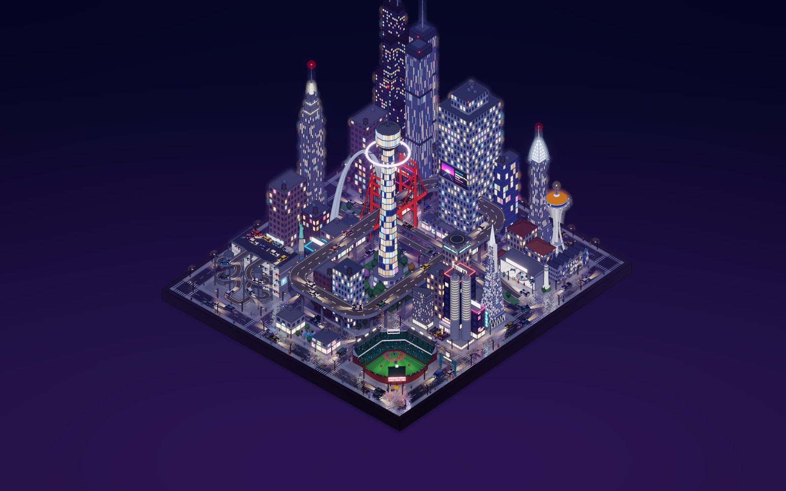
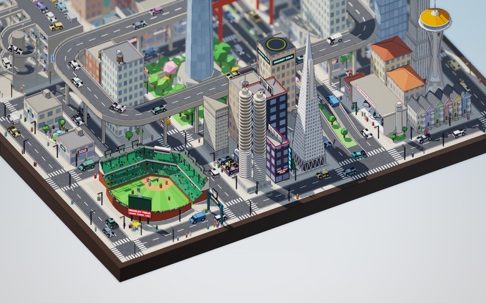
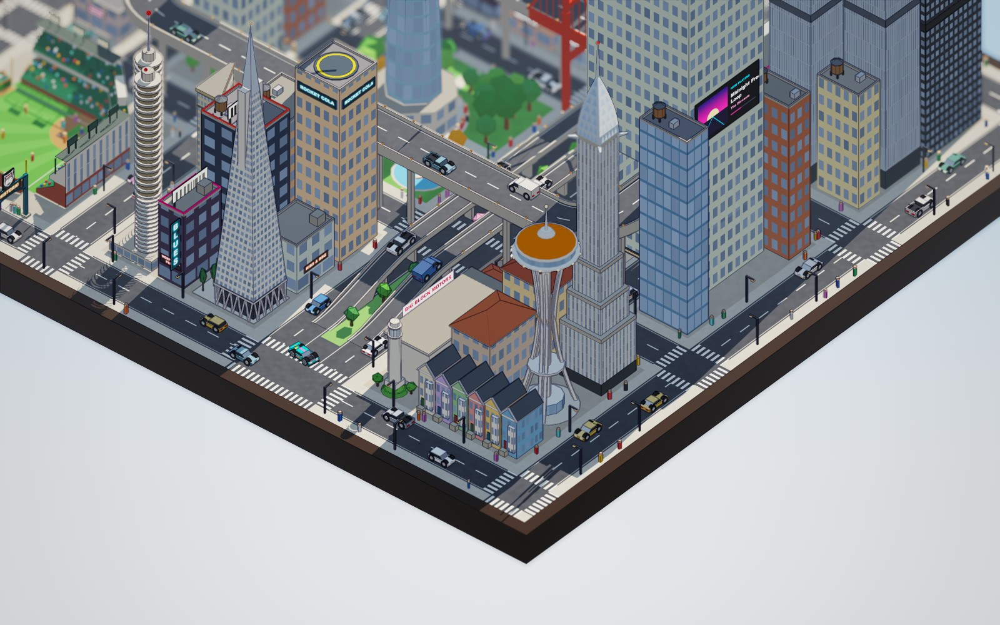
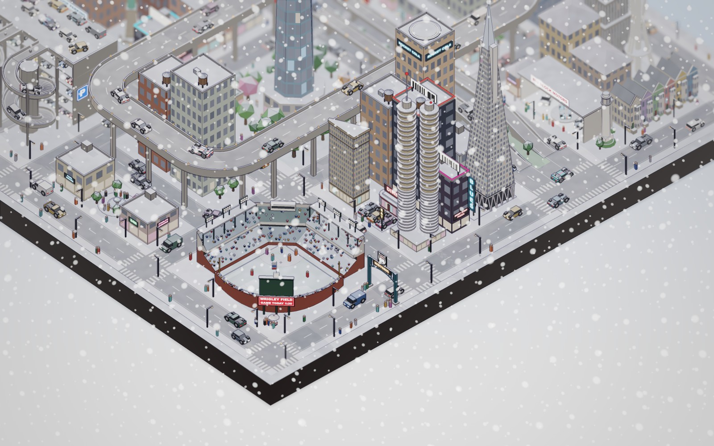
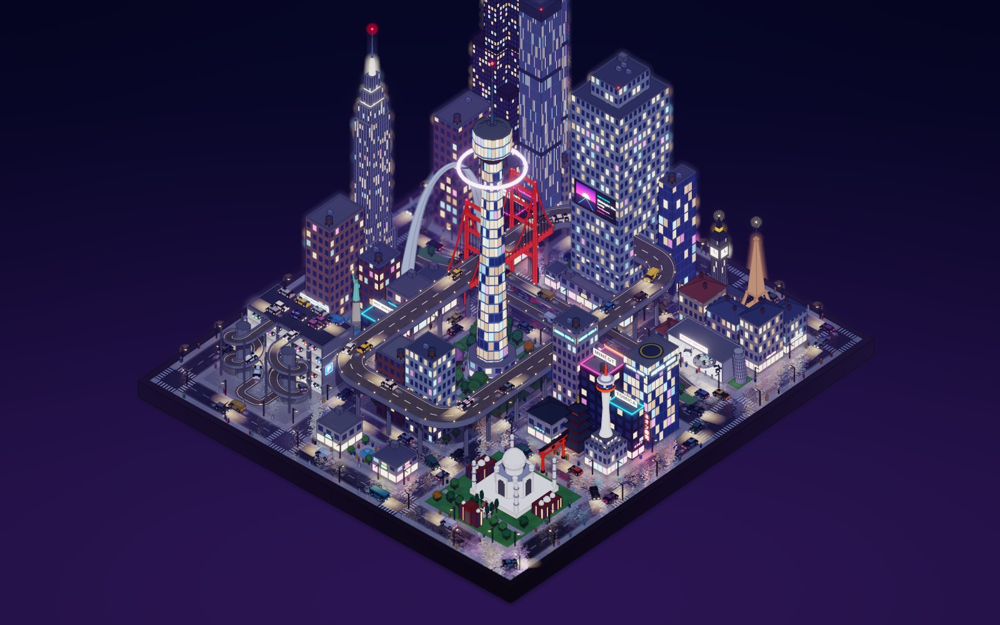
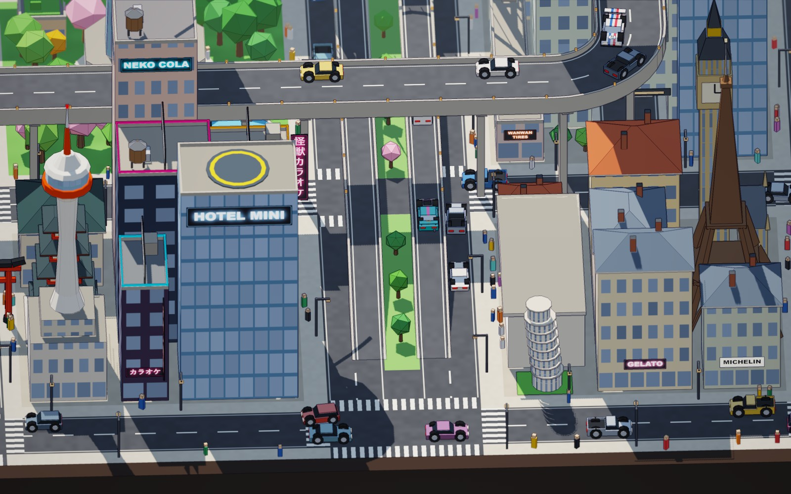
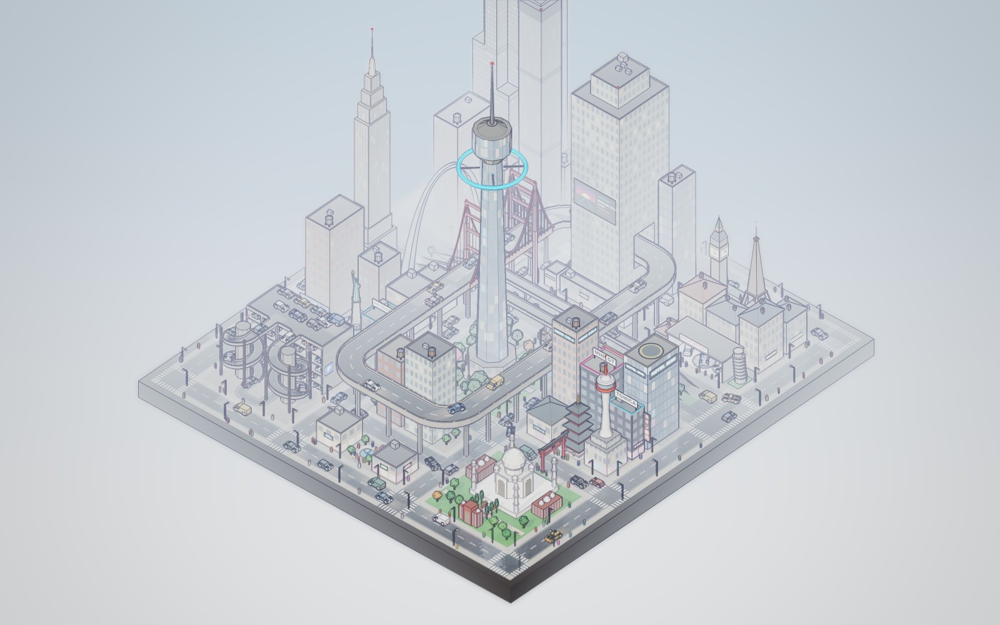

# Wimmelstadt


A living miniature city for a diecast collection.

Every Hot Wheels or Mini GT its collector adds drives around the city as a recognisable character, among plain traffic. The city sits on a screen beside the desk and simply goes about its day. It is made in the spirit of a *Wimmelbilderbuch*, the picture books where every page is crowded with small things going on: there is no score and no goal, only a place that rewards looking.

**Try it:** https://anubhavg1999.github.io/wimmelstadt/ is the app as it stands on `main`. The published city has traffic and no heroes, because heroes are made from the collector's own pictures, which stay private. The look prototype it grew out of is at https://anubhavg1999.github.io/wimmelstadt/look/.

Drag to move, right-drag to turn, scroll to zoom, and drag the dial at the bottom from day to night.

## The intent

A diecast collection mostly sits in boxes or on a shelf. Wimmelstadt gives each one a life.

- **A diecast becomes a hero.** The collector photographs the toy from six angles, or for a Mini GT simply picks its page on Mini GT's site, whose three product pictures are enough. A cloud service turns the pictures into a 3D model, which is finished at a bench: wheels that spin, lights, its true size, its decals restored, and the photographic shine flattened into the city's slightly cartoony look. Once approved, it arrives in the city on a car transporter.
- **A hero is found by its detail alone.** Nothing glows and nothing is marked. Traffic is plain, so the one car with a number on its door is somebody.
- **Heroes have lives.** They keep a routine tied to the real clock, gather at a meet in the evening, and now and then one does doughnuts under a bridge.
- **The city is made of tiles, and it is permanent.** Each tile is one district, built by hand around a real or an imagined place: Hong Kong, Delhi, Merseyside, the Alps, Route 66's desert, Westeros behind its Wall. Every tile is packed with things to recognise, and no tile is another one in different clothes. Nothing already built ever moves, because the fun is in coming back to a place you know. The city grows a tile at a time. What grows with the collection is the number of heroes.
- **It is a thing to leave on.** It runs as a web app on a phone on a stand and in a desktop browser. By day it is a bright, warm miniature. At night it turns to neon, haze and wet streets. The weather is the city's own: rain, storms, fog and snow come and go.

It is deliberately not a collection manager: no prices, no wish lists, no checklists of what is missing.

## Where it stands

| Part | State |
| --- | --- |
| The design | Agreed. See the [brief](docs/brief.md), the [glossary](CONTEXT.md) and the [decision records](docs/adr). |
| A prototype of the look | Built. It was meant as a throwaway: one small hand-built scene. Its board turned out to be the right size and shape for a tile, and became the first one. See [prototype/look](prototype/look). |
| A trial of the generators | Done. Rodin 2.5 made a good hero from Mini GT's own three pictures, at $0.40 a car. See [prototype/hero](prototype/hero). |
| Research | Done for all 23 districts, with sources. See [docs/districts/research](docs/districts/research). |
| A first attempt at the city | Built and set aside: one continuous island of 23 districts. Beside the prototype its density and its layout did not hold up. It is kept on the branch `island-prototype`, where every document says why. |
| A first try at tiles | Built and set aside: two larger tiles, blocked out side by side. Beside the prototype they were too thinly filled. See [prototype/two-tiles](prototype/two-tiles). |
| The city | Begun: hand-built tiles, one district each. The first, North America, is built, and the first real hero drives on it. See [app](app) and [0009](docs/adr/0009-a-city-of-hand-built-tiles.md). |

The order of building is: this prototype, then the city, then the pipeline that turns photos into heroes, then life in the city, then music, then extras.

## The city

The city is made of tiles. A tile is one district on a board of its own, built by hand, lot by lot, until nothing in it is filler. It is the size of the look prototype's board, because that board turned out to be the right size: small enough that its landmarks stand shoulder to shoulder, with a ring of raised expressway squeezed between them and streets passing underneath. Each tile stands on its own base, like a model on a table.

The first tile is North America, and it is the prototype's board itself. The Sears Tower, the Twin Towers, the Empire State Building, the Statue of Liberty, the Gateway Arch and the Golden Gate Bridge were on it already, with the city's invented things: Halo Tower in the park, the Gate Tower the expressway runs through, the showroom and the car park with its spirals. Its European and Asian landmarks gave way to the Chrysler Building, the Space Needle, Coit Tower, the Painted Ladies, the Transamerica Pyramid, the Flatiron Building, Marina City, a diner, an arch for Route 66 and Wrigley Field.

| | |
| --- | --- |
|  |  |
| Half past nine in the evening. | Wrigley Field, the arch for Route 66, the diner and Marina City. |
|  |  |
| Marina City, the Transamerica Pyramid and the Flatiron Building. | The Chrysler Building, the Space Needle, the Painted Ladies and Coit Tower. |
|  |  |
| A night game. | Snow. |

Two other forms of the city were built first and set aside. One was a continuous island with a coast, rivers and mountains. It was too large to build by hand, so the ground between its landmarks was filled with ordinary buildings made by rule, and it looked empty where the prototype looks full. It is kept on the branch `island-prototype`. The other was a pair of larger tiles joined by an avenue, which thinned out in the same way. It is kept in [prototype/two-tiles](prototype/two-tiles). [0009](docs/adr/0009-a-city-of-hand-built-tiles.md) records both.

How the tiles will sit together, and how a hero will get from one to the next, is not decided yet.

## The look prototype

These pictures come from the look prototype: the same board before it became North America, which is why Big Ben and the Taj Mahal are in them. The heroes in them are stand-ins drawn by hand.

| | |
| --- | --- |
|  |  |
| Half past nine in the evening. | Dusk, from the south-west. |
|  |  |
| A hero among plain traffic. | A hero on the flyover at night, and another on the expressway above. |
|  |  |
| America: the Sears Tower, the Twin Towers, the Empire State Building, the Gateway Arch, the Golden Gate and the Statue of Liberty. | Europe: Big Ben, the Eiffel Tower and the Leaning Tower of Pisa. |
|  |  |
| Asia at night: Kyoto Tower, a pagoda behind its torii, and the Taj Mahal. | The flyover comes down between Asia and Europe. |
|  |  |
| Rain. | Snow. |
|  |  |
| Fog. | The car park and its spiral ramps. |

Famous landmarks stand in the city as toy versions of themselves, each on the tile of its own place. Most brands on the signs are invented. A few are real names from car culture, set in plain lettering.

## What is in this repository

| Path | What it is |
| --- | --- |
| [docs/brief.md](docs/brief.md) | The agreed design, in full. Start here. |
| [CONTEXT.md](CONTEXT.md) | The glossary: what a diecast, a hero, a casting, a district and the rest mean here. |
| [docs/adr](docs/adr) | Nine short records of decisions that would be hard to undo, each with its reason. |
| [docs/districts/research](docs/districts/research) | The research notes behind each of the 23 districts: what stands where, what it looks like, and what was and was not checked. |
| [app](app) | The real app, built with three.js. So far one tile, North America. |
| [prototype/look](prototype/look) | The look prototype. Its README says what to judge and what is faked. |
| [prototype/two-tiles](prototype/two-tiles) | The first try at tiles, set aside. Its README says why, and what is worth taking from it. |
| [prototype/hero](prototype/hero) | The generator trial: prepares a diecast's pictures, runs them through image-to-3D services and shows the models side by side. The pictures and models themselves stay private. |

## Run it

```bash
cd app
npm install
npm run dev
```

Then open http://localhost:5187. The look prototype runs the same way from `prototype/look`, on port 5183.

## A note on names

This is a personal hobby project. Hot Wheels, Mini GT, Goodyear, Tomica, Advan, Michelin and Pirelli are trademarks of their owners. Their names appear here and on a few signs in the city as a nod from a fan, in plain lettering and without their logos. This project is not affiliated with or endorsed by any of them.

The same goes for the places. Real buildings, clubs, circuits and businesses are named as a visitor would name them, without logos or crests, and each is drawn as a toy in the project's own hand. Westeros is the world of George R. R. Martin's *A Song of Ice and Fire*. It appears here as a fan's homage after the books' descriptions, not for sale, and with no connection to the author, his publishers or the makers of the television series.
