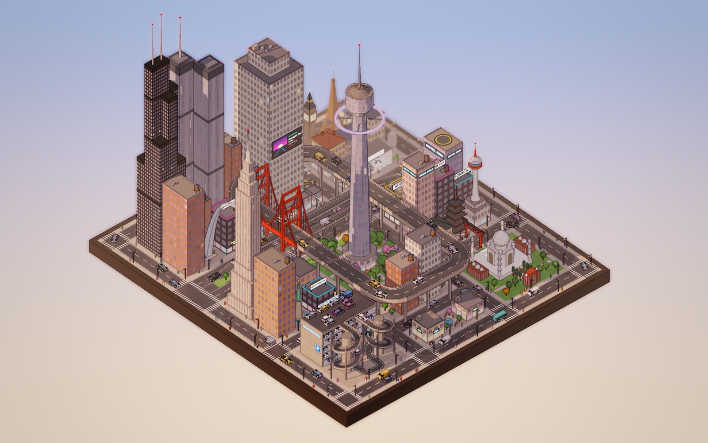
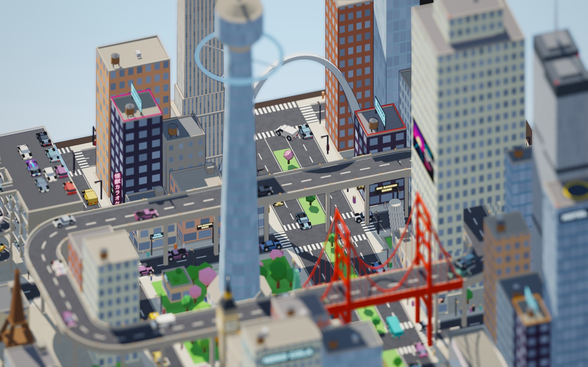
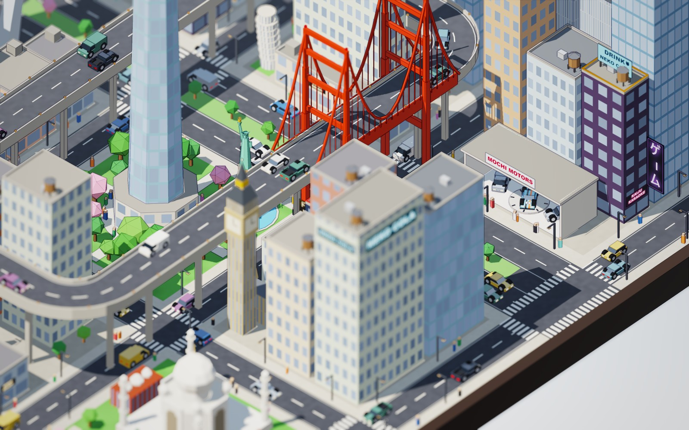
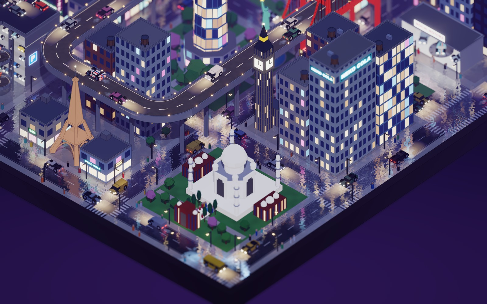

# Wimmelstadt


A living miniature city for a diecast collection.

Every Hot Wheels or Mini GT its collector adds drives around the city as a recognisable character, among plain traffic. The city sits on a screen beside the desk and simply goes about its day. It is made in the spirit of a *Wimmelbilderbuch*, the picture books where every page is crowded with small things going on: there is no score and no goal, only a place that rewards looking.

**Try the look prototype:** https://anubhavg1999.github.io/wimmelstadt/

Drag to move, right-drag to turn, scroll to zoom, and drag the dial at the bottom from day to night.

## The intent

A diecast collection mostly sits in boxes or on a shelf. Wimmelstadt gives each one a life.

- **A diecast becomes a hero.** The collector photographs the toy from six angles. A cloud service turns the photos into a 3D model, which is finished at a bench: wheels that spin, lights, its true size, and its decals restored from the photos. Once approved, it arrives in the city on a car transporter.
- **A hero is found by its detail alone.** Nothing glows and nothing is marked. Traffic is plain, so the one car with a number on its door is somebody.
- **Heroes have lives.** They keep a routine tied to the real clock, gather at a meet in the evening, and now and then one does doughnuts under a bridge.
- **The city is permanent and only grows.** A new district is added for every ten heroes or so. Nothing already built ever moves, because the fun is in coming back to a place you know.
- **It is a thing to leave on.** It runs as a web app on a phone on a stand and in a desktop browser. By day it is a bright, warm miniature. At night it turns to neon, haze and wet streets.

It is deliberately not a collection manager: no prices, no wish lists, no checklists of what is missing.

## Where it stands

| Part | State |
| --- | --- |
| The design | Agreed. See the [brief](docs/brief.md), the [glossary](CONTEXT.md) and the [decision records](docs/adr). |
| A prototype of the look | Built, and what every picture here shows. It is a throwaway: one small hand-built scene. See [prototype/look](prototype/look). |
| The real app | Not started. |

The order of building is: this prototype, then the pipeline that turns photos into heroes, then the city, then life in it, then music, then growth.

## Pictures

All of these come from the look prototype. The heroes in them are stand-ins drawn by hand. Real heroes will be made from photos of the actual toys.

| | |
| --- | --- |
|  |  |
| The same city at half past nine in the evening. | Dusk, from the south-west. |
|  |  |
| A hero among plain traffic. | A hero on the wet boulevard, passing the showroom. |
|  |  |
| The Gateway Arch spans the boulevard. | The Golden Gate carries the expressway. The Statue of Liberty stands in the park's pond. |
|  |  |
| The Taj Mahal, Big Ben and the Eiffel Tower at night. | The car park and its spiral ramps. |

Famous landmarks are scattered through the city as toy versions of themselves: the Sears Tower, the Twin Towers, the Empire State Building, the Statue of Liberty, the Gateway Arch, the Golden Gate Bridge, the Taj Mahal, Big Ben, the Eiffel Tower and the Leaning Tower of Pisa. Every brand on a sign is invented.

## What is in this repository

| Path | What it is |
| --- | --- |
| [docs/brief.md](docs/brief.md) | The agreed design, in full. Start here. |
| [CONTEXT.md](CONTEXT.md) | The glossary: what a diecast, a hero, a casting, a district and the rest mean here. |
| [docs/adr](docs/adr) | Five short records of decisions that would be hard to undo, each with its reason. |
| [prototype/look](prototype/look) | The look prototype, built with three.js. Its README says what to judge and what is faked. |

## Run the prototype

```bash
cd prototype/look
npm install
npm run dev
```

Then open http://localhost:5183.

## A note on names

This is a personal hobby project. Hot Wheels and Mini GT are trademarks of their owners, and this project is not affiliated with or endorsed by them.
