# Wimmelstadt


A living miniature city for a diecast collection.

Every Hot Wheels or Mini GT its collector adds drives around the city as a recognisable character, among plain traffic. The city sits on a screen beside the desk and simply goes about its day. It is made in the spirit of a *Wimmelbilderbuch*, the picture books where every page is crowded with small things going on: there is no score and no goal, only a place that rewards looking.

**Try it:** https://anubhavg1999.github.io/wimmelstadt/ is the app as it stands on `main`. The published city has traffic alone until it is unlocked. Its heroes are made from the collector's own pictures, so they sit behind a PIN, and whoever the collector gives the PIN to can see them. The look prototype it grew out of is at https://anubhavg1999.github.io/wimmelstadt/look/.

Drag to move, right-drag to turn, and scroll to zoom. Double-click a tile to go to it, and the table to see the whole board again. Drag the sun round the dial at the bottom right from day to night, and pick the weather from the tokens round it.

## The intent

A diecast collection mostly sits in boxes or on a shelf. Wimmelstadt gives each one a life.

- **A diecast becomes a hero.** The collector photographs the toy from six angles, or for a Mini GT simply picks its page on Mini GT's site, whose three product pictures are enough. A cloud service turns the pictures into a 3D model, which is finished at a bench: wheels that spin, lights, its true size, its decals restored, and the photographic shine flattened into the city's slightly cartoony look. Once approved, it arrives in the city on a car transporter.
- **A hero is found by its detail alone.** Nothing glows and nothing is marked. Traffic is plain, so the one car with a number on its door is somebody.
- **Heroes have lives.** They keep a routine tied to the real clock, gather at a meet in the evening, and now and then one does doughnuts under a bridge.
- **The city is made of tiles, and it is permanent.** Each tile is one district, built by hand around a real or an imagined place: Hong Kong, Delhi, Merseyside, the Alps, Route 66's desert, Westeros behind its Wall. Every tile is packed with things to recognise, and no tile is another one in different clothes. Nothing already built ever moves, because the fun is in coming back to a place you know. The city grows a tile at a time. What grows with the collection is the number of heroes.
- **It is a thing to leave on.** It runs as a web app on a phone on a stand and in a desktop browser. By day it is a bright, warm miniature. At night it turns to neon, haze and wet streets. The weather is the city's own: rain, storms, fog and snow come and go.

It is deliberately not a collection manager: no prices, no wish lists, no checklists of what is missing.

## Where it stands

| Part | State |
| --- | --- |
| The design | Agreed. See the [brief](docs/brief.md), the [glossary](CONTEXT.md) and the [decision records](docs/adr). |
| A prototype of the look | Built. It was meant as a throwaway: one small hand-built scene. Its board turned out to be the right size and shape for a tile, and became the first one. See [prototype/look](prototype/look). |
| A trial of the generators | Done. Rodin 2.5 made a good hero from Mini GT's own three pictures, at $0.40 a car. See [prototype/hero](prototype/hero). |
| Research | Done for all 23 districts, with sources. See [docs/districts/research](docs/districts/research). |
| A first attempt at the city | Built and set aside: one continuous island of 23 districts. Beside the prototype its density and its layout did not hold up. It is kept on the branch `island-prototype`, where every document says why. |
| A first try at tiles | Built and set aside: two larger tiles, blocked out side by side. Beside the prototype they were too thinly filled. See [prototype/two-tiles](prototype/two-tiles). |
| The city | Three tiles are built and stand together on a board: North America, Japan and Hong Kong. More are being built. See [app](app), [0009](docs/adr/0009-a-city-of-hand-built-tiles.md) and [0010](docs/adr/0010-the-tiles-stand-together-on-a-table.md). |
| Heroes | One, the black Countach from the generator trial, carried through by hand. It drives in the published city for whoever has the collector's PIN. See [0011](docs/adr/0011-the-heroes-sit-behind-a-pin.md). The pipeline that makes a hero from the phone is not built. |

The order of building is: this prototype, then the city, then the pipeline that turns photos into heroes, then life in the city, then music, then extras.

## The city

The city is made of tiles. A tile is one district on a board of its own, built by hand, lot by lot, until nothing in it is filler. It is the size of the look prototype's board, because that board turned out to be the right size: small enough that its landmarks stand shoulder to shoulder, with roads squeezed between them and streets passing underneath. Each tile stands on its own base, like a model on a table, with its name on a brass plate. The tiles stand together on one table, edge to edge, and that table is the board.

Three tiles are built, each to the same [page for tile builders](docs/building-a-tile.md). Each keeps notes in its own folder: what stands on it, the liberties taken with the real place, and every real name on a sign.

### North America

The first tile is the prototype's board itself. The Sears Tower, the Twin Towers, the Empire State Building, the Statue of Liberty, the Gateway Arch and the Golden Gate Bridge were on it already, with the city's invented things: Halo Tower in the park, the Gate Tower the expressway runs through, the showroom and the car park with its spirals. Its European and Asian landmarks gave way to the Chrysler Building, the Space Needle, Coit Tower, the Painted Ladies, the Transamerica Pyramid, the Flatiron Building, Marina City, a diner, an arch for Route 66 and Wrigley Field. An elevated railway, the L, runs round its east side and out to two more stations, and a helicopter keeps taking off from a rooftop.

| | |
| --- | --- |
|  | 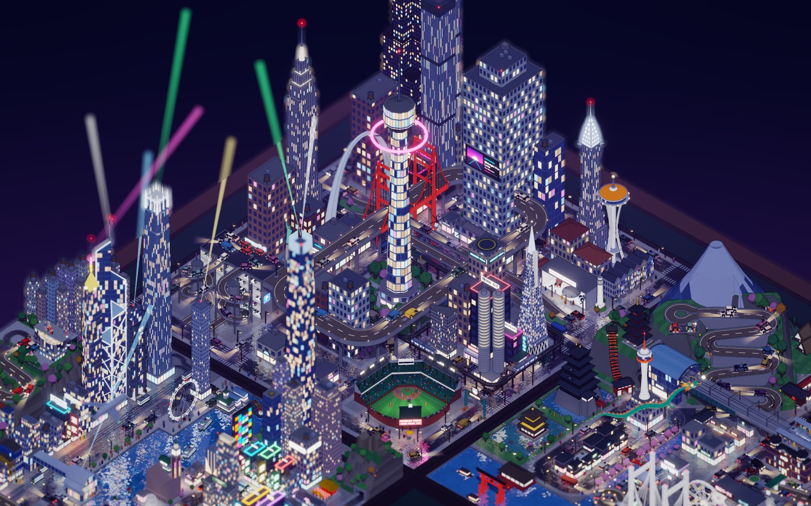 |
| North America, with Hong Kong in front of it and Japan beside it. | Half past nine in the evening. |
| 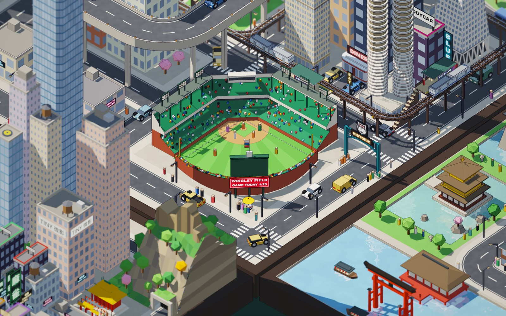 | 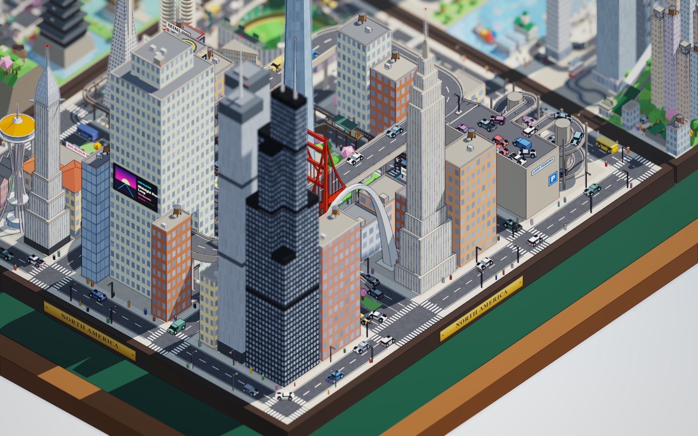 |
| Wrigley Field, the L, the diner and Marina City, where three tiles meet. | From the north-west: the Sears Tower, the Empire State Building, the Gateway Arch, the Golden Gate Bridge and the car park. |

See its [notes](app/src/tiles/north-america/NOTES.md).

### Japan

Mount Fuji fills one corner, with a pass of five hairpins climbing it. Below it Kyoto stands on one bank of a river and Tokyo on the other, with a Shinkansen between them. Kyoto has its five-storey pagoda, Fushimi Inari's tunnel of gates, Kyoto Tower, a castle in its moat, Kinkaku-ji on its pond, and a great torii standing in the water. Tokyo has Tokyo Tower, Tokyo Station, Shibuya's scramble under a tower of screens, Sensō-ji, and Ueno Park under cherry blossom. For a collector of diecasts there is the Wangan with its Bay Bridge, Daikoku and Tatsumi parking areas, a tuner's garage, and a tofu shop at the foot of the pass. A dragon flies over all of it. It has 41 things to find.

| | |
| --- | --- |
|  | 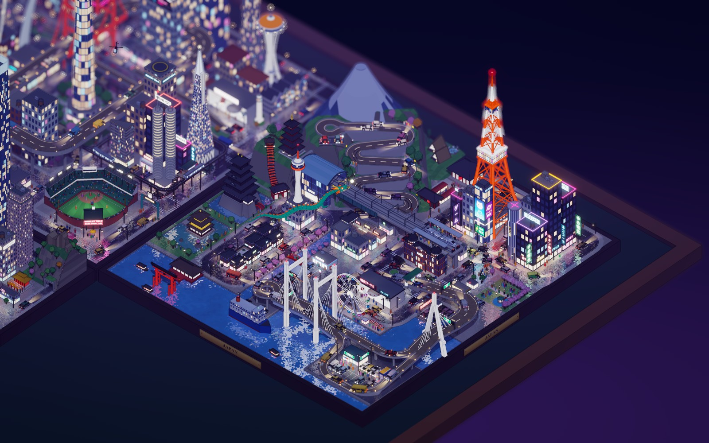 |
| Japan. | At night. |
| 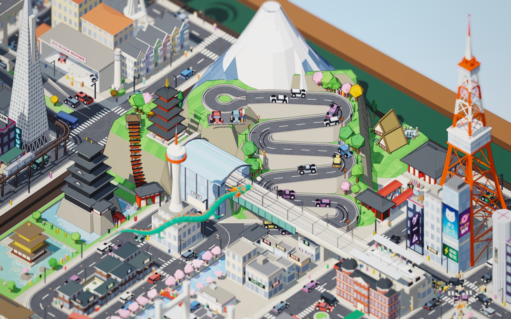 |  |
| Fuji and its pass, the pagoda, Kyoto Tower, the dragon and the Shinkansen. | Tokyo at night: Tokyo Tower, Shibuya, the station and the Ferris wheel. |

See its [notes](app/src/tiles/japan/NOTES.md).

### Hong Kong

Both sides of Victoria Harbour, as seen from Kowloon. On the Island stand the Peak, with its tram and a road of hairpins, and Central's towers from Two IFC to the Bank of China. Trams run along the shore to Happy Valley's racecourse, where the horses run. The Star Ferry crosses to Tsim Sha Tsui: the Clock Tower, the Peninsula, and Nathan Road under its neon. Behind them are ICC, Lion Rock, Mong Kok's street of signs and Choi Hung's rainbow flats, and a jumbo jet goes round on the old approach to Kai Tak. It has 39 things to find.

| | |
| --- | --- |
|  |  |
| Hong Kong. | At night, with a Symphony of Lights. |
| 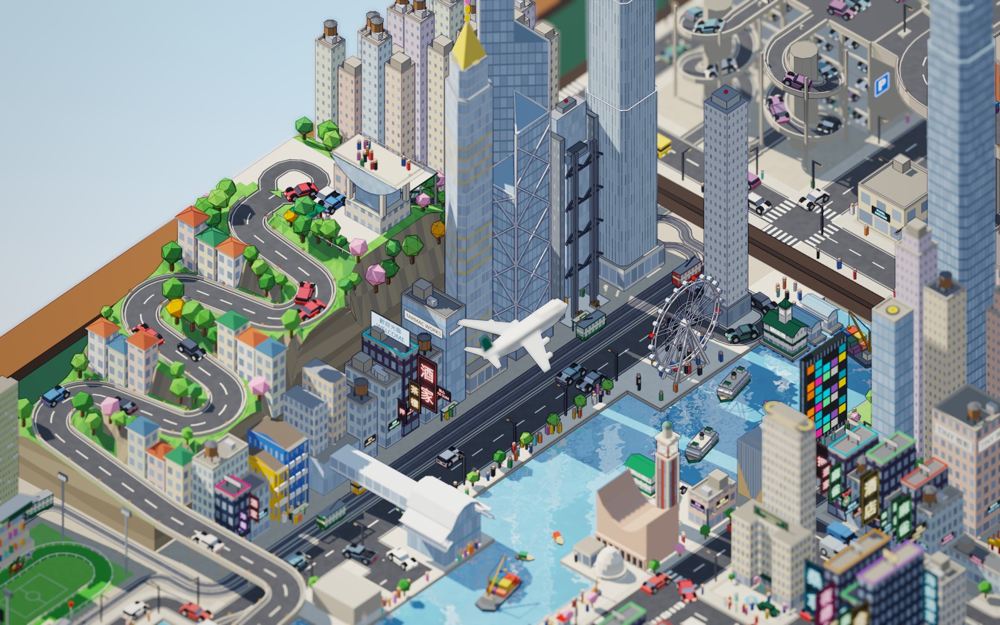 | 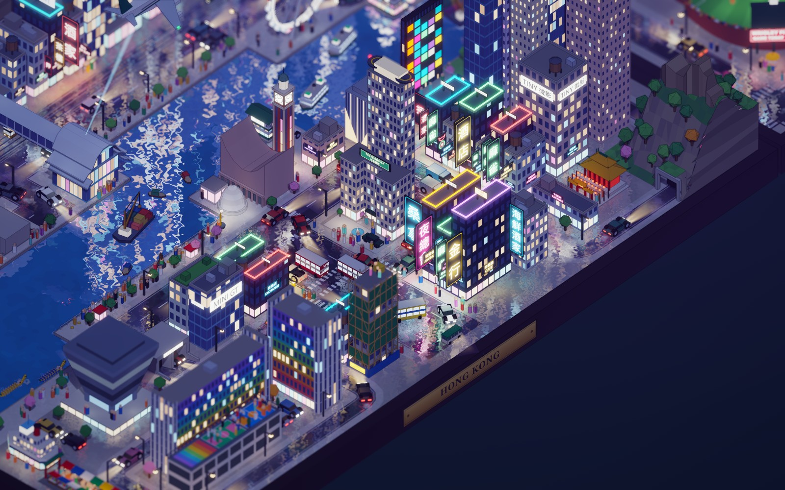 |
| The Peak, Central and the harbour. | Kowloon at night. |

See its [notes](app/src/tiles/hong-kong/NOTES.md).

### The board

| | |
| --- | --- |
| 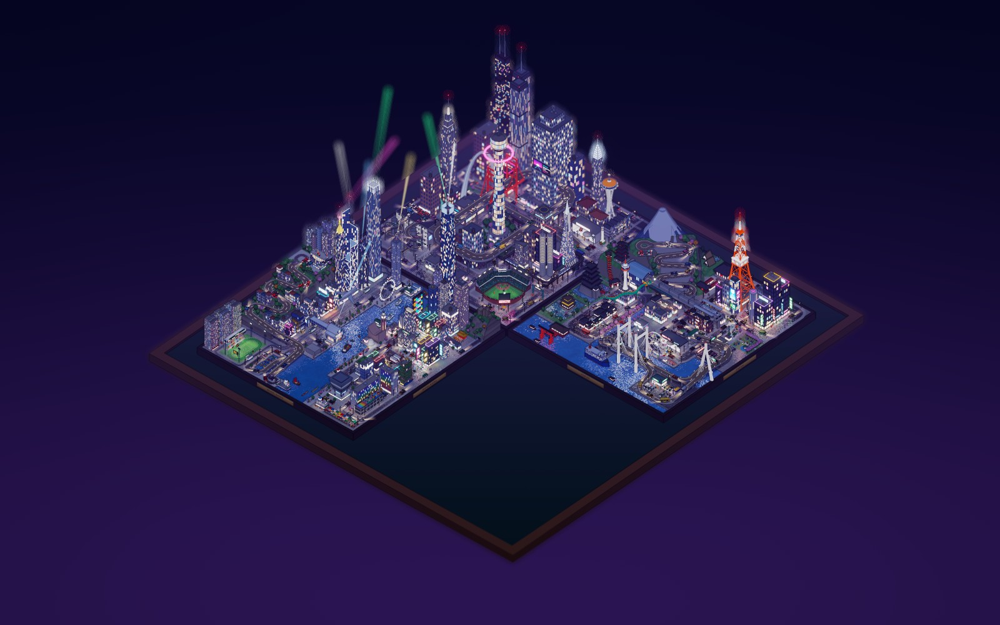 |  |
| The board at night. | Snow. |

The tiles stand on the board in the order they were built, and the fourth place is waiting for the next one. [0010](docs/adr/0010-the-tiles-stand-together-on-a-table.md) says why the tiles are joined like this. How a hero will get from one tile to the next is not decided yet: for now each hero is put on a tile at random whenever the page loads.

Two other forms of the city were built first and set aside. One was a continuous island with a coast, rivers and mountains. It was too large to build by hand, so the ground between its landmarks was filled with ordinary buildings made by rule, and it looked empty where the prototype looks full. It is kept on the branch `island-prototype`. The other was a pair of larger tiles joined by an avenue, which thinned out in the same way. It is kept in [prototype/two-tiles](prototype/two-tiles). [0009](docs/adr/0009-a-city-of-hand-built-tiles.md) records both.

## The look prototype

These pictures come from the look prototype: the same board before it became North America, which is why Big Ben and the Taj Mahal are in them. The heroes in them are stand-ins drawn by hand.

| | |
| --- | --- |
|  |  |
| Half past nine in the evening. | Dusk, from the south-west. |
|  | 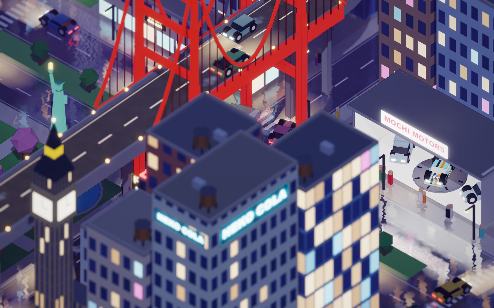 |
| A hero among plain traffic. | A hero on the flyover at night, and another on the expressway above. |
| 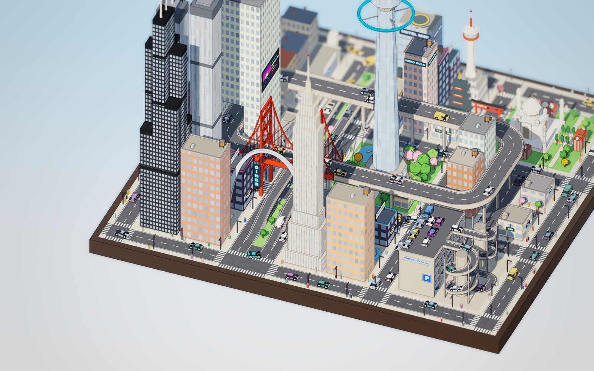 | 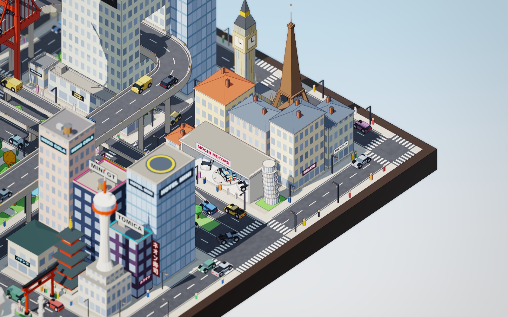 |
| America: the Sears Tower, the Twin Towers, the Empire State Building, the Gateway Arch, the Golden Gate and the Statue of Liberty. | Europe: Big Ben, the Eiffel Tower and the Leaning Tower of Pisa. |
|  |  |
| Asia at night: Kyoto Tower, a pagoda behind its torii, and the Taj Mahal. | The flyover comes down between Asia and Europe. |
|  | 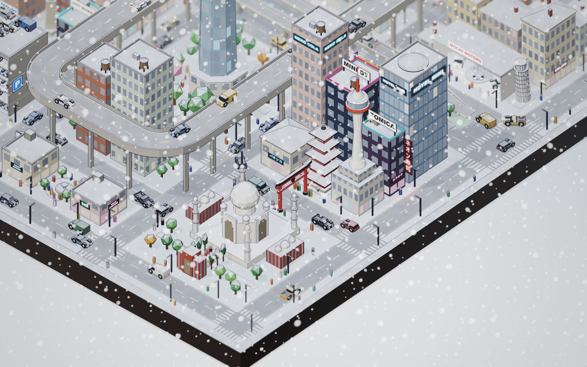 |
| Rain. | Snow. |
|  |  |
| Fog. | The car park and its spiral ramps. |

Famous landmarks stand in the city as toy versions of themselves, each on the tile of its own place. Most brands on the signs are invented. A few are real names from car culture, set in plain lettering.

## What is in this repository

| Path | What it is |
| --- | --- |
| [docs/brief.md](docs/brief.md) | The agreed design, in full. Start here. |
| [CONTEXT.md](CONTEXT.md) | The glossary: what a diecast, a hero, a casting, a tile, the board and the rest mean here. |
| [docs/adr](docs/adr) | Eleven short records of decisions that would be hard to undo, each with its reason. |
| [docs/building-a-tile.md](docs/building-a-tile.md) | The page for whoever builds a tile: what a tile is, the kit, the checks, and what the earlier tiles taught their builders. |
| [docs/districts/research](docs/districts/research) | The research notes behind each of the 23 districts: what stands where, what it looks like, and what was and was not checked. |
| [app](app) | The real app, built with three.js: an engine, and a folder for each tile. So far three tiles. |
| [supabase](supabase) | The backend's database, as the changes that made it: the heroes, the store for their models, and who may see them. |
| [prototype/look](prototype/look) | The look prototype. Its README says what to judge and what is faked. |
| [prototype/two-tiles](prototype/two-tiles) | The first try at tiles, set aside. Its README says why, and what is worth taking from it. |
| [prototype/hero](prototype/hero) | The generator trial: prepares a diecast's pictures, runs them through image-to-3D services and shows the models side by side. The pictures and models themselves stay private. |

## Run it

```bash
cd app
npm install
npm run dev
```

Then open http://localhost:5187. The look prototype runs the same way from `prototype/look`, on port 5183.

## A note on names

This is a personal hobby project. Hot Wheels, Mini GT, Tarmac Works, TINY, Goodyear, Tomica, Advan, Michelin and Pirelli are trademarks of their owners. Their names appear here and on a few signs in the city as a nod from a fan, in plain lettering and without their logos. This project is not affiliated with or endorsed by any of them.

The same goes for the places. Real buildings, clubs, circuits and businesses are named as a visitor would name them, without logos or crests, and each is drawn as a toy in the project's own hand. Westeros is the world of George R. R. Martin's *A Song of Ice and Fire*. It appears here as a fan's homage after the books' descriptions, not for sale, and with no connection to the author, his publishers or the makers of the television series.
