# Wimmelstadt

![Nine miniature cities on a green table with a wooden rim, each on a dark base of its own, in three rows of three: skyscrapers round a ring of raised road at the back, a white mountain and a red and white lattice tower to their right, a harbour city's towers at the far right, an iron lattice tower by a river at the left, domes and red sandstone in the middle, red brick to their right, and along the front a wall of ice, a great ribbed dome with a black dragon in the air over it, and a city under a clear dome with warships hanging above it.](app/screenshots/board.jpg)

A living miniature city for a diecast collection.

Every Hot Wheels or Mini GT its collector adds drives around the city as a recognisable character, among plain traffic. The city sits on a screen beside the desk and simply goes about its day. It is made in the spirit of a *Wimmelbilderbuch*, the picture books where every page is crowded with small things going on: there is no score and no goal, only a place that rewards looking.

**Try it:** https://anubhavg1999.github.io/wimmelstadt/ is the app as it stands on `main`. The published city has traffic alone until it is unlocked. Its heroes are made from the collector's own pictures, so they sit behind a PIN, and whoever the collector gives the PIN to can see them. The look prototype it grew out of is at https://anubhavg1999.github.io/wimmelstadt/look/.

Drag to move, right-drag across to turn and up or down to tilt, and scroll to zoom. Double-click a tile to go to it, and the table to see the whole board again. Drag the sun round the dial at the bottom right from day to night, and pick the weather from the tokens round it.

## The intent

A diecast collection mostly sits in boxes or on a shelf. Wimmelstadt gives each one a life.

- **A diecast becomes a hero.** The collector photographs the toy from six angles, or for a Mini GT simply picks its page on Mini GT's site, whose three product pictures are enough. A cloud service turns the pictures into a 3D model, which is finished at a bench: wheels that spin, lights, its true size, its decals restored, and the photographic shine flattened into the city's slightly cartoony look. Once approved, it arrives in the city on a car transporter.
- **A hero is found by its detail alone.** Nothing glows and nothing is marked. Traffic is plain, so the one car with a number on its door is somebody.
- **Heroes have lives.** They keep a routine tied to the real clock, gather at a meet in the evening, and now and then one does doughnuts under a bridge.
- **The city is made of tiles, and it is permanent.** Each tile is one district, built by hand around a real or an imagined place: Hong Kong, Delhi, Westeros behind its Wall, Mars under an Iron Rain. Every tile is packed with things to recognise, and no tile is another one in different clothes. Nothing already built ever moves, because the fun is in coming back to a place you know. The city grows a tile at a time. What grows with the collection is the number of heroes.
- **It is a thing to leave on.** It runs as a web app on a phone on a stand and in a desktop browser. By day it is a bright, warm miniature. At night it turns to neon, haze and wet streets. It opens under a clear sky. Give the weather to the city, and rain, storms, fog and snow come and go.

It is deliberately not a collection manager: no prices, no wish lists, no checklists of what is missing.

## Where it stands

| Part | State |
| --- | --- |
| The design | Agreed. See the [brief](docs/brief.md), the [glossary](CONTEXT.md) and the [decision records](docs/adr). |
| A prototype of the look | Built. It was meant as a throwaway: one small hand-built scene. Its board turned out to be the right size and shape for a tile, and became the first one. See [prototype/look](prototype/look). |
| A trial of the generators | Done. Rodin 2.5 made a good hero from Mini GT's own three pictures, at $0.40 a car. See [prototype/hero](prototype/hero). |
| Research | Kept for the tiles on the board, with sources: what stands in each place, and what was and was not checked. A new tile is researched when its turn comes. See [docs/districts/research](docs/districts/research). |
| A first attempt at the city | Built and set aside: one continuous island of 23 districts. Beside the prototype its density and its layout did not hold up. It is kept in the repository's history. |
| A first try at tiles | Built and set aside: two larger tiles, blocked out side by side. Beside the prototype they were too thinly filled. It is kept in the repository's history. |
| The city | Nine tiles are built and stand together on a board: North America, Japan, Hong Kong, Europe, Delhi, Urbana-Champaign, Westeros, Blackwater Bay and the Iron Rain. More are to come, and the board holds nine at a time. See [app](app), [0009](docs/adr/0009-a-city-of-hand-built-tiles.md), [0010](docs/adr/0010-the-tiles-stand-together-on-a-table.md) and [0012](docs/adr/0012-the-board-holds-nine-tiles-at-a-time.md). |
| Heroes | Fifteen: the black Countach from the generator trial, and fourteen more made from Mini GT's own pictures and finished by hand, each with a party trick of its own. They drive in the published city for whoever has the collector's PIN. See [0011](docs/adr/0011-the-heroes-sit-behind-a-pin.md). The pipeline that makes a hero from the phone is not built. |
| Music | Begun. A big screen on every tile shows what is playing on Spotify, through a link made with the listener's own account, and a picture of its own when nothing is. A device is linked from the Music row of the options. Steering the music is not built. |

The order of building is: this prototype, then the city, then the pipeline that turns photos into heroes, then life in the city, then music, then extras.

## The city

The city is made of tiles. A tile is one district on a board of its own, built by hand, lot by lot, until nothing in it is filler. It is the size of the look prototype's board, because that board turned out to be the right size: small enough that its landmarks stand shoulder to shoulder, with roads squeezed between them and streets passing underneath. Each tile stands on its own base, like a model on a table, with its name on a brass plate. The tiles stand together on one table, edge to edge, and that table is the board.

Nine tiles are built, each to the same [page for tile builders](docs/building-a-tile.md). Each keeps notes in its own folder: what stands on it, the liberties taken with the real place, and every real name on a sign.

### North America

The first tile is the prototype's board itself. The Sears Tower, the Twin Towers, the Empire State Building, the Statue of Liberty, the Gateway Arch and the Golden Gate Bridge were on it already, with the city's invented things: Halo Tower in the park, the Gate Tower the expressway runs through, the showroom and the car park with its spirals. Its European and Asian landmarks gave way to the Chrysler Building, the Space Needle, Coit Tower, the Painted Ladies, the Transamerica Pyramid, the Flatiron Building, Marina City, a diner, an arch for Route 66 and Wrigley Field. An elevated railway, the L, runs round its east side and out to two more stations, and a helicopter keeps taking off from a rooftop.

| | |
| --- | --- |
| 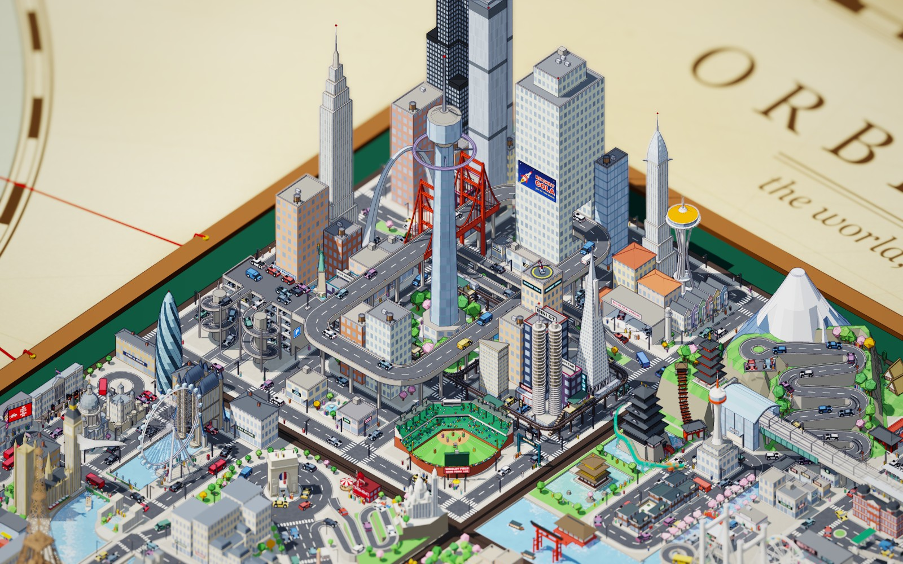 |  |
| North America, with Europe in front of it and Japan beside it. | Half past nine in the evening. |
|  |  |
| Wrigley Field, the L, the diner and Marina City, where North America meets Europe's Montmartre and Japan's Kinkaku-ji. | From the north-west: the Sears Tower, the Empire State Building, the Gateway Arch, the Golden Gate Bridge and the car park. |

See its [notes](app/src/tiles/north-america/NOTES.md).

### Japan

Mount Fuji fills one corner, with a pass of five hairpins climbing it. Below it Kyoto stands on one bank of a river and Tokyo on the other, with a Shinkansen between them. Kyoto has its five-storey pagoda, Fushimi Inari's tunnel of gates, Kyoto Tower, a castle in its moat, Kinkaku-ji on its pond, and a great torii standing in the water. Tokyo has Tokyo Tower, Tokyo Station, Shibuya's scramble under a tower of screens, Sensō-ji, and Ueno Park under cherry blossom. For a collector of diecasts there is the Wangan with its Bay Bridge, Daikoku and Tatsumi parking areas, a tuner's garage, and a tofu shop at the foot of the pass. A dragon flies over all of it. It has 41 things to find.

| | |
| --- | --- |
| 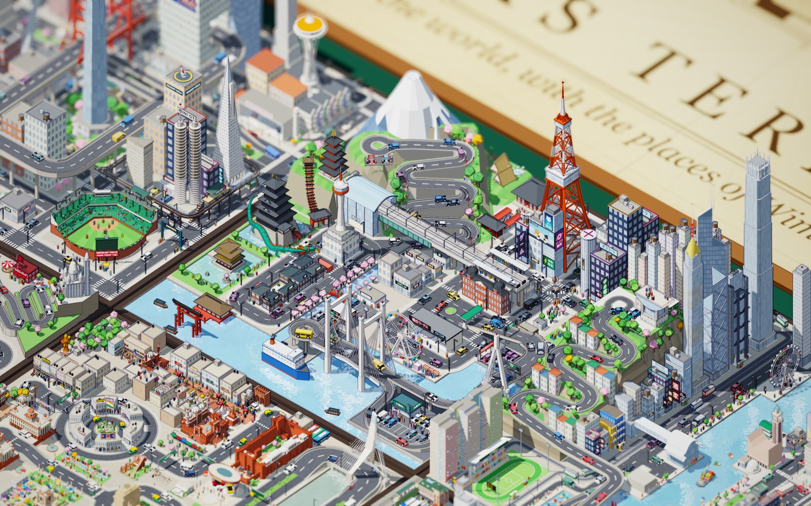 |  |
| Japan. | At night. |
|  | 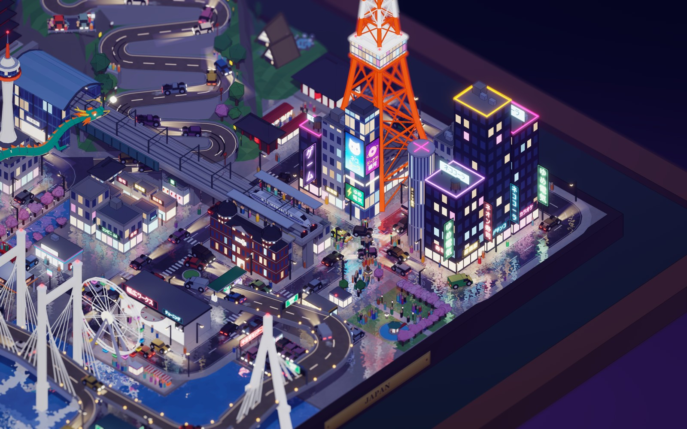 |
| Fuji and its pass, the pagoda, Kyoto Tower, the dragon and the Shinkansen. | Tokyo at night: Tokyo Tower, Shibuya, the station and the Ferris wheel. |

See its [notes](app/src/tiles/japan/NOTES.md).

### Hong Kong

Both sides of Victoria Harbour, as seen from Kowloon. On the Island stand the Peak, with its tram and a road of hairpins, and Central's towers from Two IFC to the Bank of China. Trams run along the shore to Happy Valley's racecourse, where the horses run. The Star Ferry crosses to Tsim Sha Tsui: the Clock Tower, the Peninsula, and Nathan Road under its neon. Behind them are ICC, Lion Rock, Mong Kok's street of signs and Choi Hung's rainbow flats, and a jumbo jet goes round on the old approach to Kai Tak. It has 39 things to find.

| | |
| --- | --- |
| 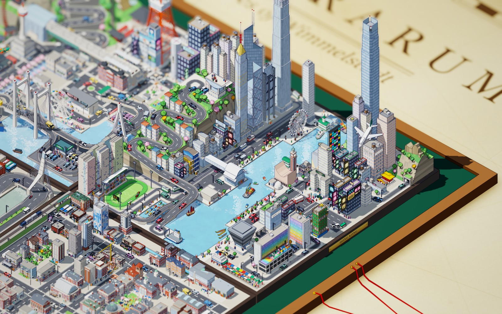 | 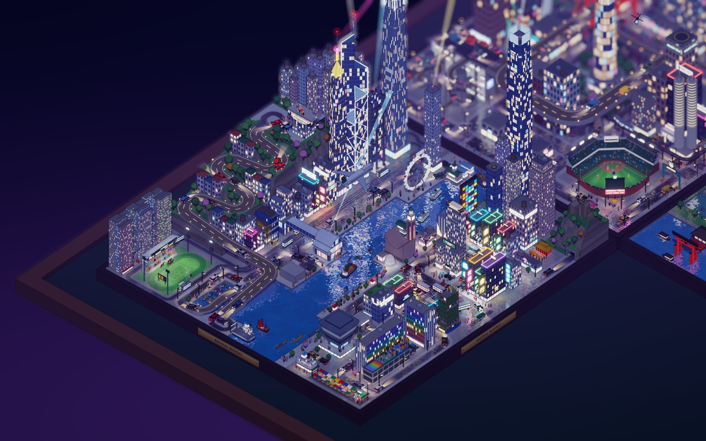 |
| Hong Kong. | At night, with a Symphony of Lights. |
|  |  |
| The Peak, Central and the harbour. | Kowloon at night. |

See its [notes](app/src/tiles/hong-kong/NOTES.md).

### Europe

One river runs through it under three names. London stands on its first bend: the Houses of Parliament and Big Ben, Tower Bridge, the Tower, the London Eye, St Paul's, Buckingham Palace with its guard marching, Piccadilly Circus, the Gherkin, and Ace Cafe with a line of cars outside. Paris is on the second: the Eiffel Tower in open ironwork, the Arc de Triomphe in its star, the Louvre and its pyramid, Notre-Dame on its island, Sacré-Cœur on Montmartre and the Moulin Rouge. Beyond them is Italy: the Leaning Tower of Pisa, the Colosseum, Florence's cathedral, the Ponte Vecchio, a canal of Venice, and for a collector of diecasts Lingotto with the test track on its roof and the gates of Maranello and Sant'Agata. London keeps left, and Paris and Italy keep right. Concorde flies a round over all of it, and a balloon drifts over the left bank. It has 29 things to find.

| | |
| --- | --- |
| 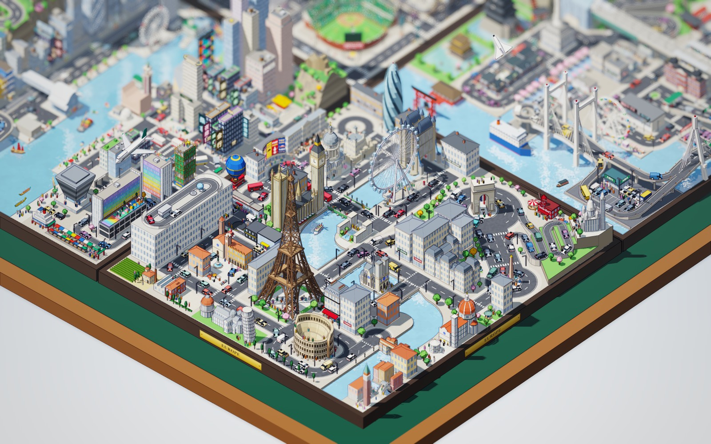 | 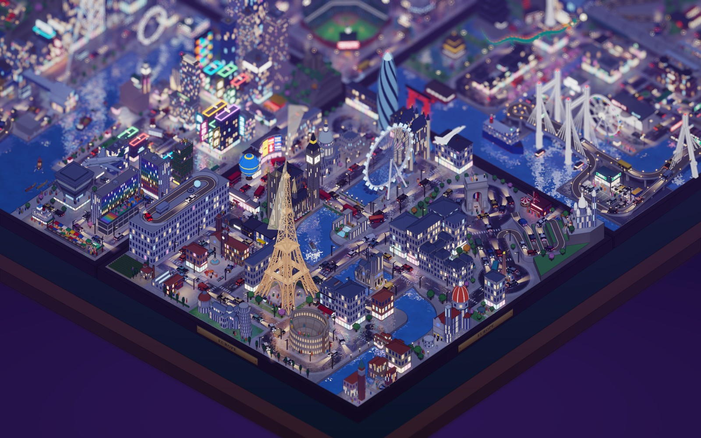 |
| Europe. | At night. |
| 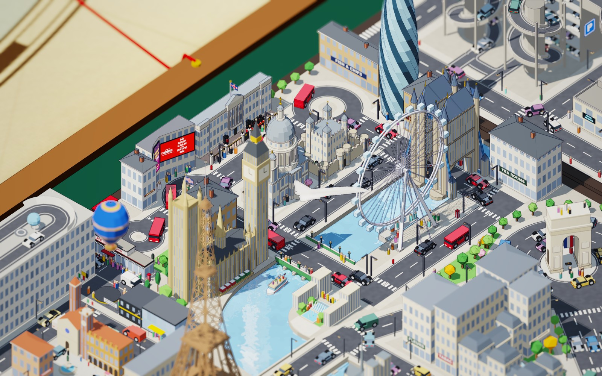 | 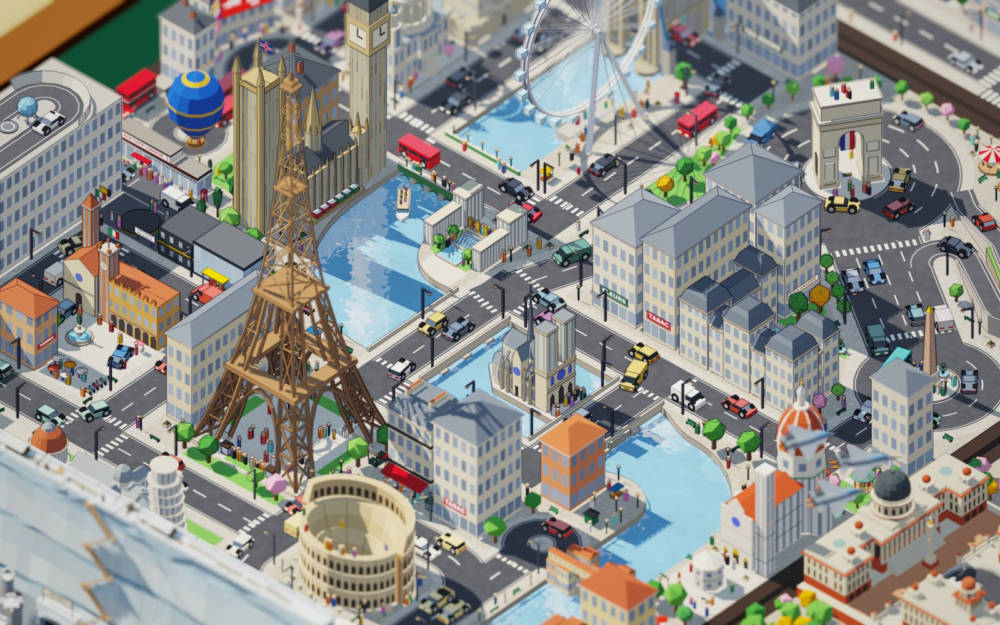 |
| London: Parliament and Big Ben, the Eye, St Paul's, the Tower, Tower Bridge, the Gherkin, Piccadilly Circus and Ace Cafe. | Paris and Italy: the Eiffel Tower, the Colosseum, Pisa, the Arc de Triomphe, Notre-Dame and Florence's cathedral. |

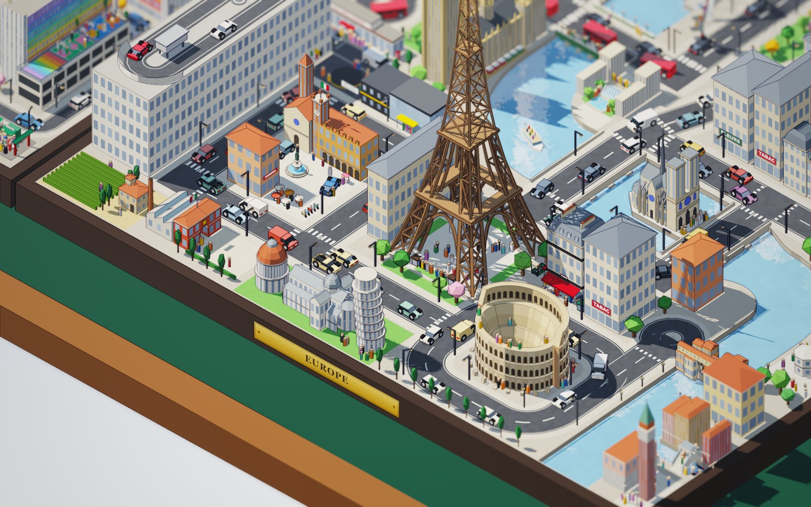

Lingotto, with the test track on its roof, Pisa, the Colosseum and the Eiffel Tower, from the north-east, with Westeros's Wall behind them on the next tile.

See its [notes](app/src/tiles/europe/NOTES.md).

### Delhi

Old Delhi fills the north: the Red Fort with an elephant either side of its Delhi Gate, Jama Masjid, Chandni Chowk with its cycle rickshaws, Khari Baoli's spice market, and kites over the roofs. Connaught Place stands west of the middle, with the tile's screen on its colonnade, and Karol Bagh's street of car accessories beyond it. Across the middle runs the axis, from Rashtrapati Bhavan on Raisina Hill, between North and South Block and down Kartavya Path to India Gate. The south has Humayun's Tomb, Lodhi Garden, Khan Market, Dilli Haat, Hauz Khas round its tank, the Qutub Minar and the Lotus Temple, and the Metro runs on its viaduct along the Ring Road and over the Yamuna to Akshardham. For a collector of diecasts there are the Auto Expo at Bharat Mandapam, a vintage rally lined up at the National Stadium, and the corner of the Buddh circuit on the far bank. Autos, cycle rickshaws and buses are its traffic, and three grey jets fly a round over it, trailing saffron, white and green on every third pass. It has 44 things to find.

| | |
| --- | --- |
|  | 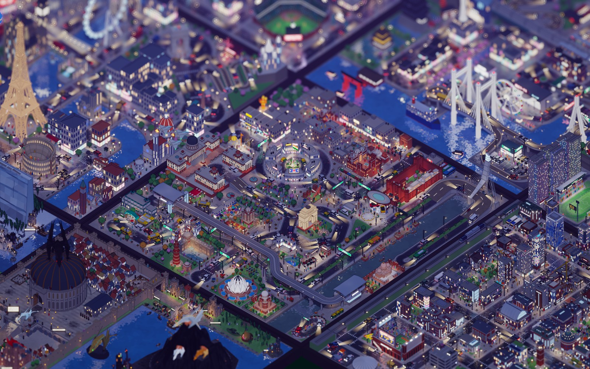 |
| Delhi. | At night. |
| 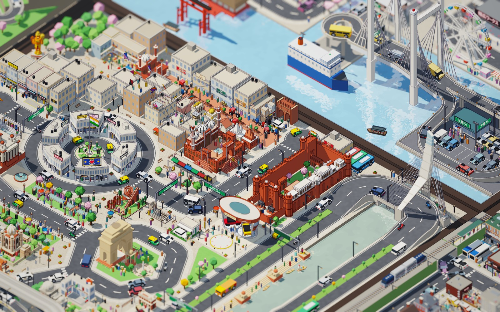 |  |
| Old Delhi and the centre: the Red Fort, Jama Masjid, Connaught Place with its screen, India Gate, and the Signature Bridge over the Yamuna. | The flypast over Rashtrapati Bhavan and the two Blocks, with Connaught Place, the Red Fort, India Gate, the Metro and the Qutub Minar. |

See its [notes](app/src/tiles/delhi/NOTES.md).

### Urbana-Champaign

The campus of the University of Illinois in the first weeks of the autumn term, with Campustown to its west and a strip of Urbana to its east. The Main Quad is on Quad Day, its lawn full of stalls between the Illini Union and Foellinger Auditorium, with Altgeld Hall's bell tower and Alma Mater at its north-west corner and the Morrow Plots in corn. North of Green Street stand Engineering Hall, the Bardeen Quad and the Siebel Center. Campustown has its bars, its towers and Illinois Terminal by the railway, and the Marching Illini form up outside the Armory. In the south-west, cars are unloading at the Six Pack's halls, a home game fills Gies Memorial Stadium with a crop duster towing a banner round it, and there is a tailgate beside State Farm Center. Basil Thai is on Gregory Street in Urbana, and the Round Barns and a field of corn at harvest close the south edge. Each of the university's buildings has a blue board with its name. It has 48 things to find.

| | |
| --- | --- |
|  | 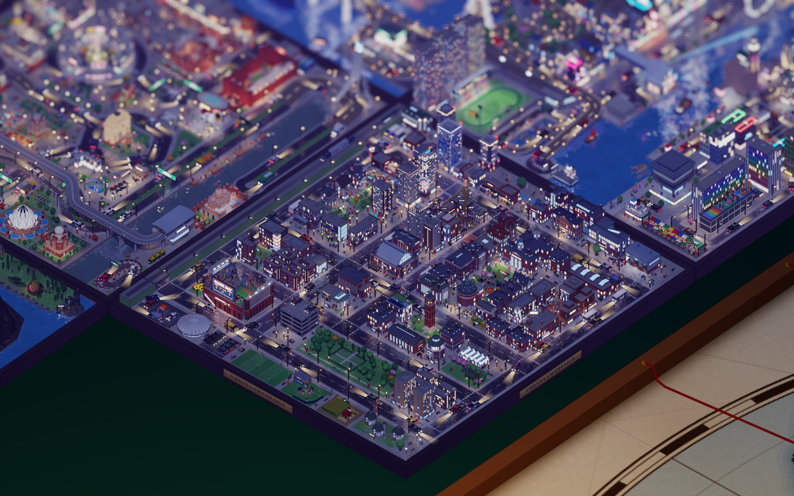 |
| Urbana-Champaign. | At night. |
| 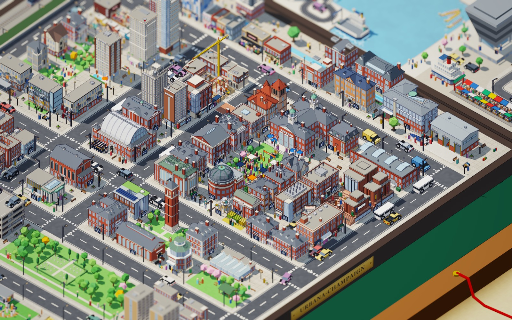 | 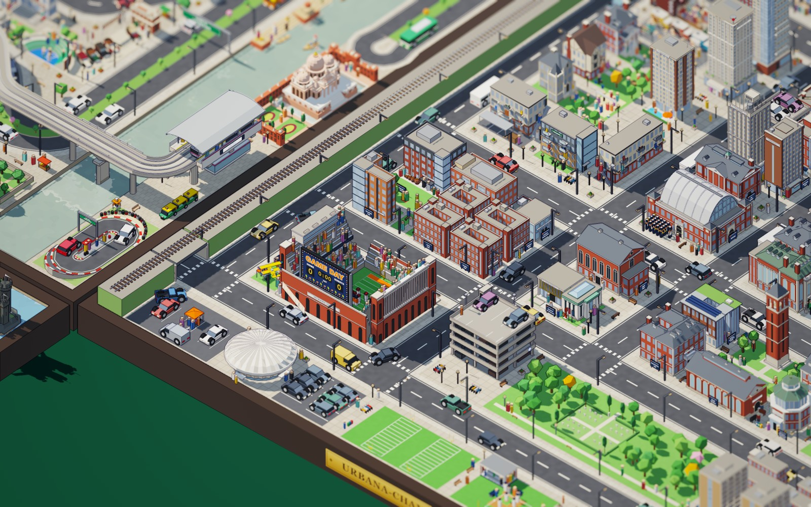 |
| The Main Quad on Quad Day, between the Illini Union and Foellinger Auditorium, with the Armory and the Marching Illini at the left and the McFarland bell tower in front. | Game day at Gies Memorial Stadium, with the crop duster, State Farm Center, the deck at Fourth and Pennsylvania and the Six Pack's halls, and the railway between the campus and Delhi. |

See its [notes](app/src/tiles/uiuc/NOTES.md).

### Westeros

The continent of *A Song of Ice and Fire*, after the books and with nothing from the television series. The Wall closes its north edge, with Castle Black at its foot, a switchback stair and a winch cage up the ice, and Eastwatch and the Shadow Tower at its ends. Below it lie Winterfell and Winter Town, White Harbor, Moat Cailin and the Neck, and the Twins over the Green Fork. The riverlands have Riverrun, Harrenhal by the Gods Eye and the Inn at the Crossroads, the Eyrie stands on the Giant's Lance, and Casterly Rock and Pyke are in the west. King's Landing stands on its three hills with the Red Keep, the Great Sept of Baelor and the ruined Dragonpit, across the water from Dragonstone and its smoking mountain, and in the south are Storm's End, Highgarden, Oldtown's Hightower and Sunspear. Riders, carts and wains travel its roads. Three dragons fly over it and breathe fire, three ships sail its seas, and a kraken comes up in the channel by the Hightower. For a collector of diecasts there are a rally stage on the kingsroad and a tourney ground. It has 64 things to find.

| | |
| --- | --- |
|  | 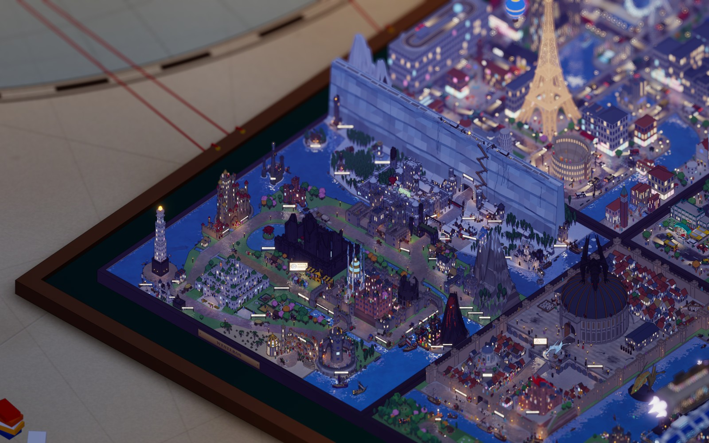 |
| Westeros. | At night. |
| 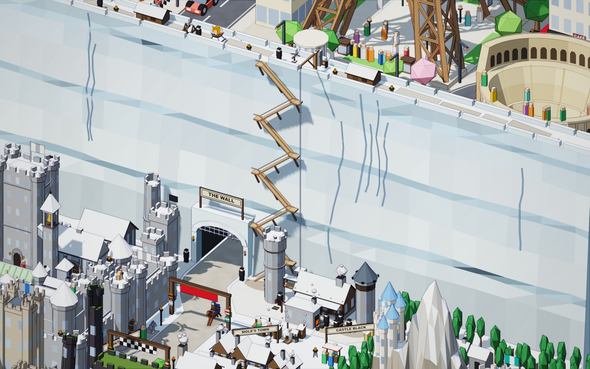 | 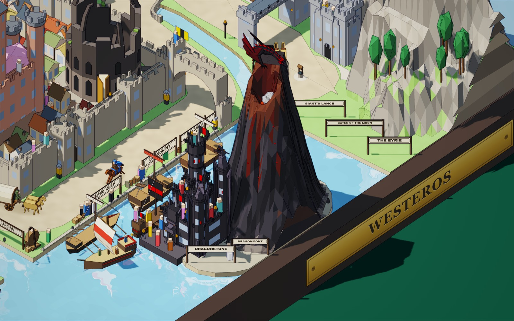 |
| The Wall: its gate, the switchback stair and the winch cage, Castle Black, Mole's Town and the rally stage's finish. | Drogon on the rim of the Dragonmont, above Dragonstone, with King's Landing across the water. |


King's Landing, with the Red Keep, the Great Sept of Baelor and the ruined Dragonpit inside its walls, Harrenhal and the tourney ground behind it, and Dragonstone, the Giant's Lance, Storm's End and Sunspear round it. At the right is the edge of Blackwater Bay: the same city some hundred and seventy years earlier.

See its [notes](app/src/tiles/westeros/NOTES.md).

### Blackwater Bay

Blackwater Bay in the year 129 after the Conquest, the age of *Fire & Blood*, after the books and with nothing from the television series. King's Landing stands behind its walls with the Dragonpit whole on the Hill of Rhaenys, a drum of forty bays under a dome of lead and bronze, the Red Keep with Maegor's Holdfast, and a sept on Visenya's Hill. Along the north shore run Rosby, Stokeworth, Duskendale and Rook's Rest. Across the water are Dragonstone, its black castle shaped as dragons under the smoking Dragonmont, and Driftmark with Hull, Spicetown and High Tide on its tidal causeway, and the Velaryon fleet rides at anchor in the Gullet. Drovers, a lord's litter and gold cloaks travel its roads. Ten great dragons of the Targaryens live on it, each at a home of its own: Balerion on the dome and Dreamfyre on the forecourt below him, Caraxes on the Red Keep's great tower, Vhagar on a rock in the bay, Meleys on High Tide, Meraxes on the Dragonmont's summit, and Vermithor, Silverwing, Sheepstealer and the Cannibal in its caves. They did not all live at one time, and gathering them is the tile's liberty. Each plays moments of its own from the books, two or three in the air at once: Balerion laps the city and breathes his black fire straight up, Sheepstealer carries a sheep home, Meleys races Caraxes round the bay, and the three dragons of the Conquest go round King's Landing one behind another. No rider is shown, and fire goes only straight up or out over open water. It has 63 things to find.

| | |
| --- | --- |
|  | 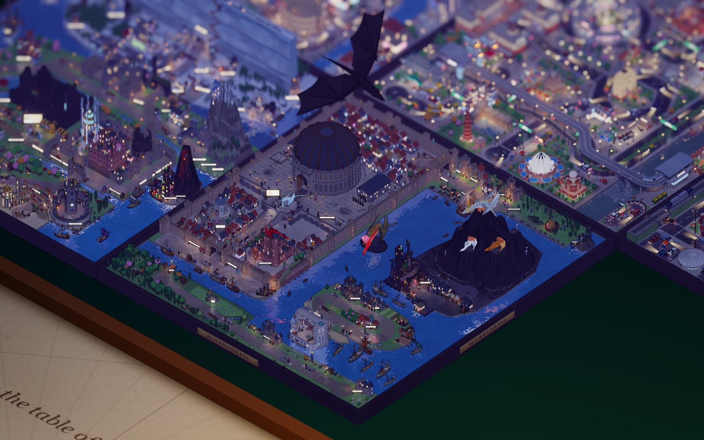 |
| Blackwater Bay, with Balerion in the air over the Dragonpit. | At night, the Dragonmont aglow. |
|  | 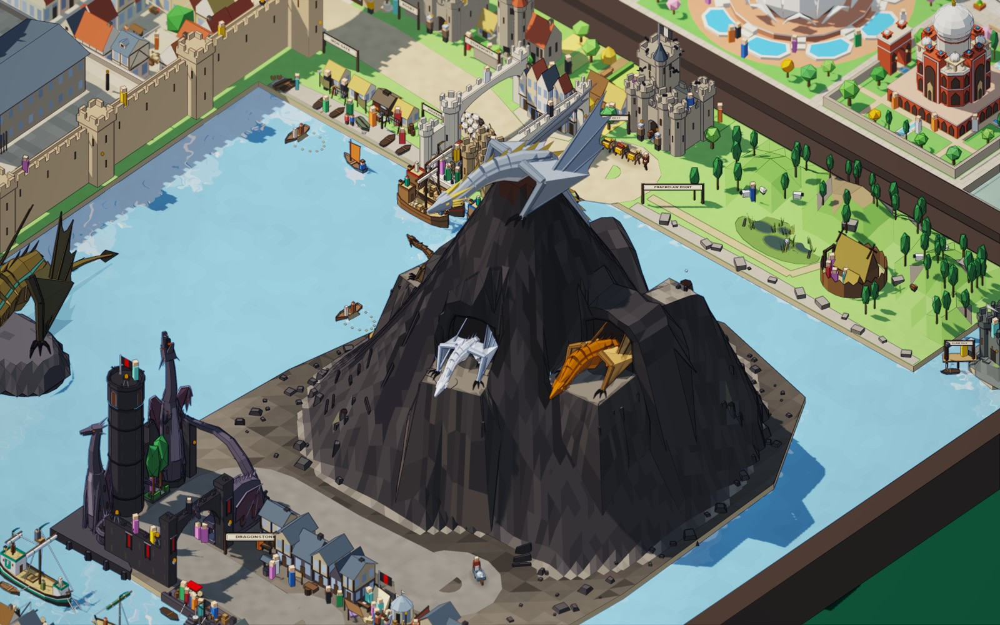 |
| The Dragonpit: Balerion on the dome and Dreamfyre on the forecourt, among the Dragonkeepers. | The Dragonmont: Meraxes on the summit, Silverwing and Vermithor before their caves, Dragonstone at its foot and Vhagar on her rock. |

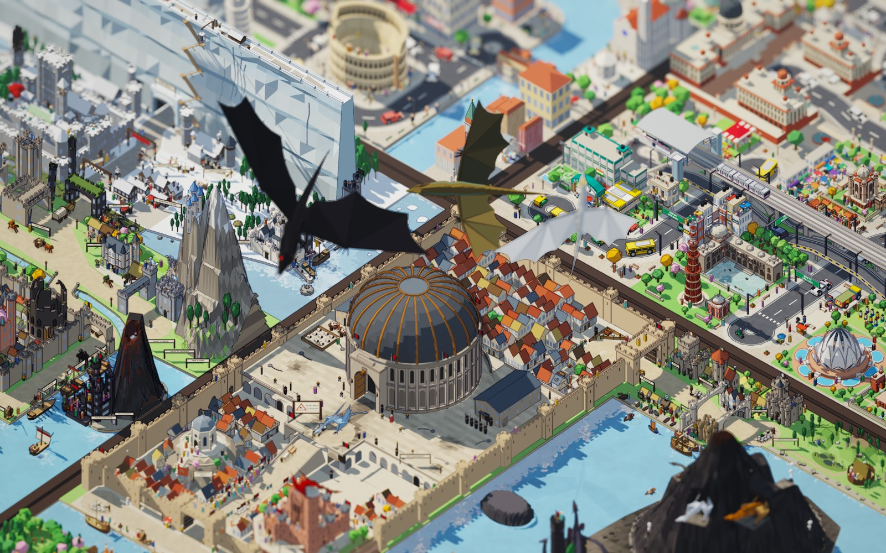

The dragons of the Conquest over King's Landing: Balerion, Vhagar and Meraxes.

See its [notes](app/src/tiles/blackwater-bay/NOTES.md).

### The Iron Rain

Mars on the day of the Lion's Rain, from Pierce Brown's *Golden Son*, after the books alone. The tile's ground is a dome of the planet, green since its terraforming, with red rock where the ground is bare. Agea, the capital, lies in the canyon across its crown: the Citadel with its seven needle spires and its landing pads, six towers like jewelled blades, the walls with their gates and the grates where the river comes through, a quarter of plastered houses round a market, and the park of pylons that hold a shield over the whole city. Above them fly eleven warships: the Pax and the Morning Star with the Augustan line, the Bellona flagship Warchild in blue and silver, and ships of the Rim. The Rain never stops: every seventeen seconds a wave of forty starShells falls from the fleet in trails of fire, and those aimed at the city skid off the shield until it is brought down. Twenty-five figures of the saga are on it at the size of the tile's people, told by their colours, cloaks and arms, among them Darrow, Sevro and the Howlers, Ragnar, Mustang, Lorn and Alexandar, the Sovereign, Aja and Cassius. They play thirteen small stories, several at once, and every fight stops at the clash: the Reaper's squadron lands before the south wall, Ragnar forces the postern, the shield breaks, and Darrow and his companions close a ring round Aja before the Sovereign's shuttle. Its traffic is the army's column of hover skiffs, gravBikes and haulers, with spider tanks on patrol. Portraying named characters is the collector's own choice for this tile, and bringing figures of different years together is its liberty. It has 49 things to find.

| | |
| --- | --- |
|  | 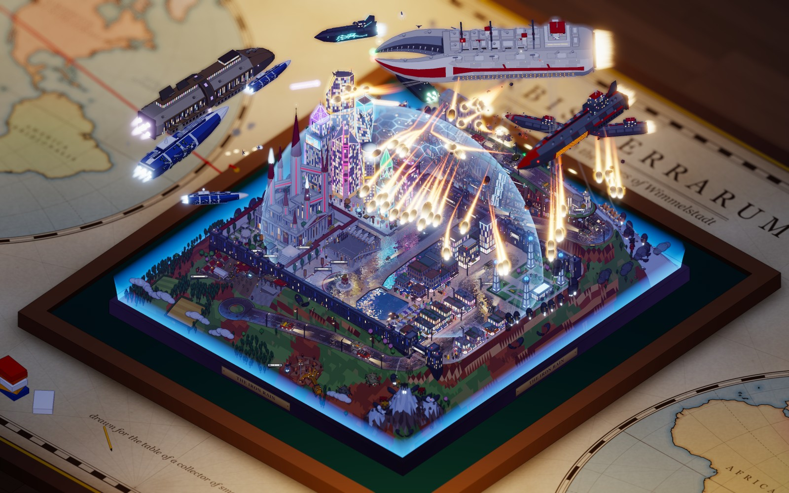 |
| The Iron Rain, with a wave falling. | At night, a wave from the Morning Star breaking on the shield. |
| 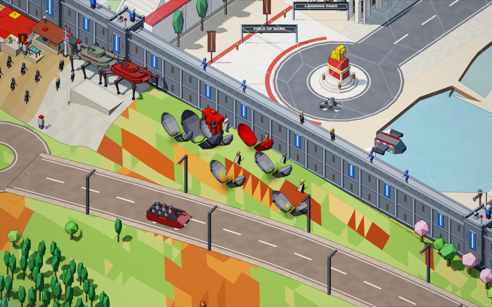 | 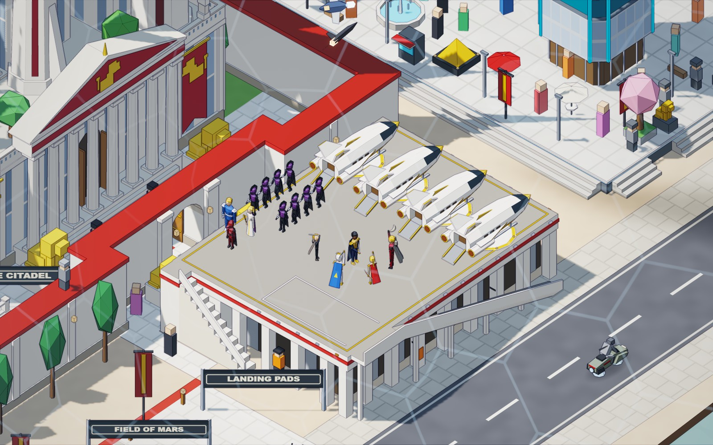 |
| The Reaper's squadron before the south wall, out of its starShells. | The ring round Aja on the Citadel's landing pads, before the Sovereign's shuttle and its decoys. |

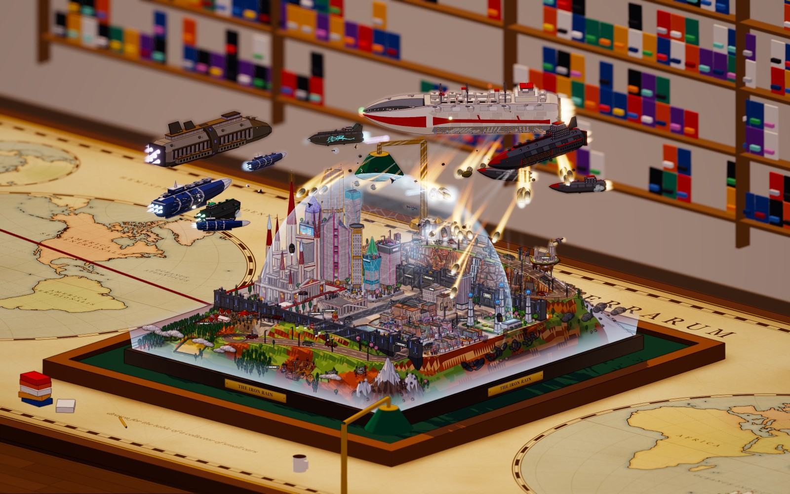

The dome of Mars at dusk, under its fleet and the Rain.

See its [notes](app/src/tiles/red-rising/NOTES.md).

### The board

| | |
| --- | --- |
|  | 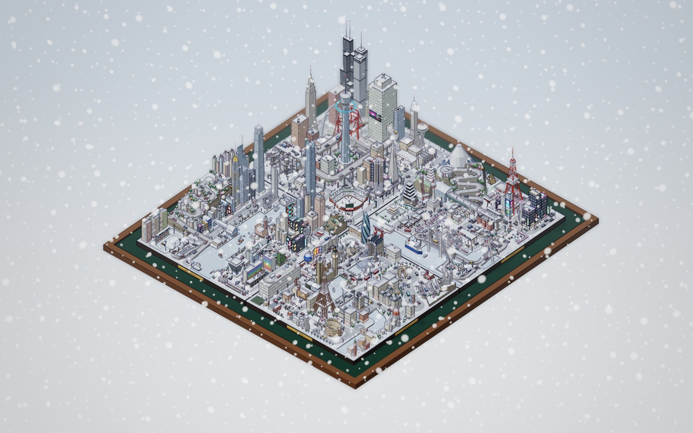 |
| The board at night. | Snow. |

The board has nine places, in three rows of three, and it stays that size however many tiles are built: [0012](docs/adr/0012-the-board-holds-nine-tiles-at-a-time.md) says why. Each time the page loads, nine tiles are dealt onto it by chance, so that whoever opens it finds a board they have not seen. With nine tiles built, that changes only where each one stands. When there are more, the ones that are left out wait in the box for another load. The key with nine squares, beside the dial, opens the picker. It shows the table from above with a postcard of each tile, and there anybody can drag a tile to another place, bring one in from the box, deal afresh, or have their device keep the board they have set. These pictures show the tiles in the order they were built, which `?order=fixed` gives: North America, Japan and Hong Kong at the back, Europe, Delhi and Urbana-Champaign in the middle, and Westeros, Blackwater Bay and the Iron Rain at the front. Most of the tiles' own pictures were taken before the Iron Rain joined them, whose fleet hangs over whatever stands behind it. [0010](docs/adr/0010-the-tiles-stand-together-on-a-table.md) says why the tiles are joined like this. How a hero will get from one tile to the next is not decided yet: for now each hero is put on a tile at random whenever the page loads.

Two other forms of the city were built first and set aside. One was a continuous island with a coast, rivers and mountains. It was too large to build by hand, so the ground between its landmarks was filled with ordinary buildings made by rule, and it looked empty where the prototype looks full. The other was a pair of larger tiles joined by an avenue, which thinned out in the same way. Both are kept only in the repository's history, and [0009](docs/adr/0009-a-city-of-hand-built-tiles.md) records them.

### The room

The table stands in the collector's room, which is the background of everything. It rests on a long walnut desk whose top is an old map of the world, drawn as the double-hemisphere maps of the seventeenth century were: the New World in a round picture on the left and the Old World in one on the right, the two poles in the corners, a compass rose, Latin names for the continents and seas, and washes of colour along the coasts, on yellowed paper with creases. Each tile has a pin in the map at its place, with its name beside it and a red thread from the pin to a brass tack on the table's edge. Round the desk are a floor of boards, shelves of small cars in their boxes, tall windows that show the colour of the sky at the hour, and four brass lamps with green shades that light the map at night.

It is all at the scale of the cars, so the desk is long and the room is a hall. A wall that would stand between the view and the table is left off, as the front of a doll's house is, and comes back as the view turns. The view is kept inside the room: however it is turned, tilted or drawn back, it shows nothing beyond the floor and the walls. The coastlines are Natural Earth's 1:50m land, which is in the public domain.

| | |
| --- | --- |
| 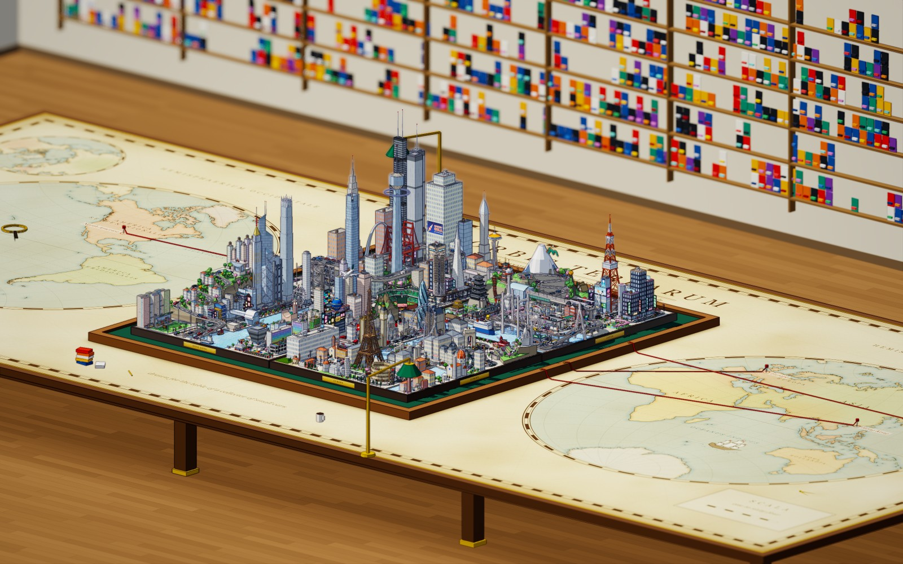 | 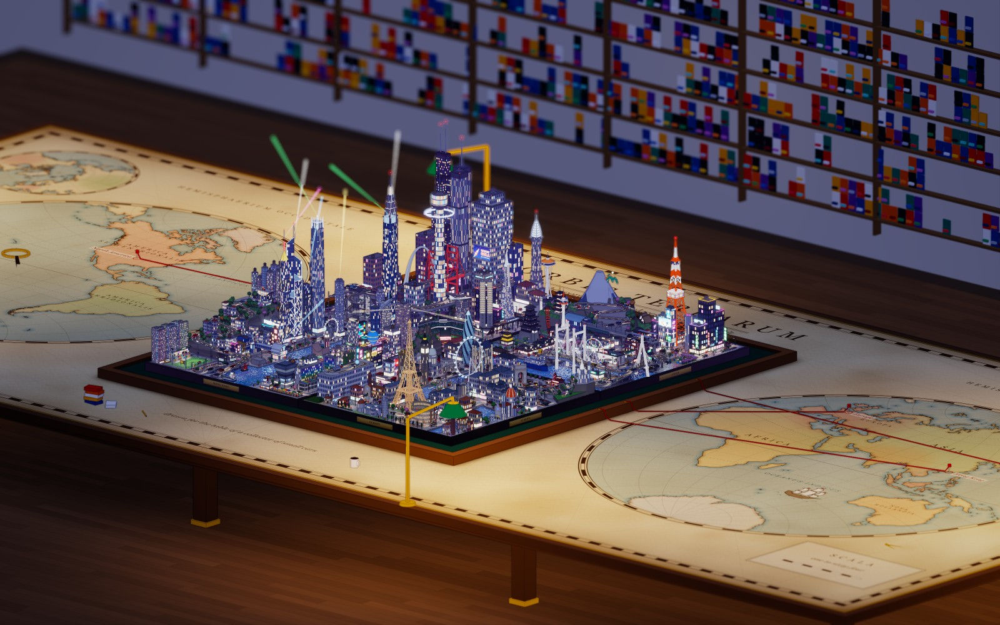 |
| The room by day. | At night, under the lamps. |

| | |
| --- | --- |
| 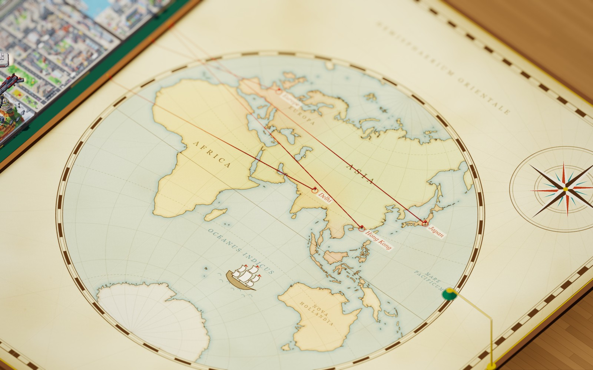 |  |
| The Old World, with the pins of Europe, Delhi, Hong Kong and Japan. | The New World, with the pins of North America and Urbana-Champaign; the land that Westeros brings to the map, lettered Hic sunt dracones, here be dragons, with Blackwater Bay's pin on its coast; and Mars, a round land of its own in the northern ocean. |

## The look prototype

These pictures come from the look prototype: the same board before it became North America, which is why Big Ben and the Taj Mahal are in them. The heroes in them are stand-ins drawn by hand.

| | |
| --- | --- |
|  |  |
| Half past nine in the evening. | Dusk, from the south-west. |
| 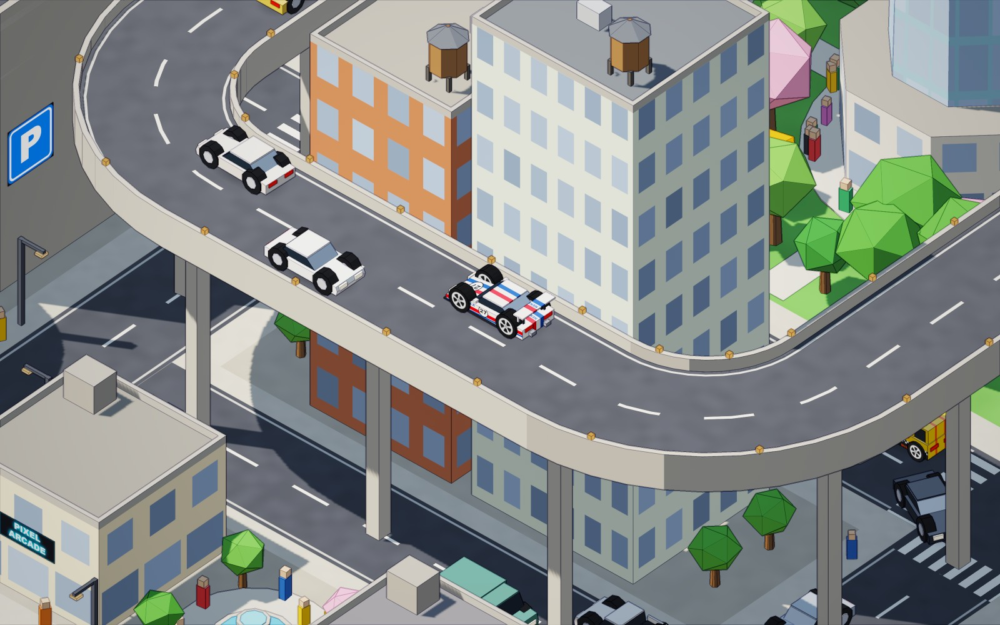 |  |
| A hero among plain traffic. | A hero on the flyover at night, and another on the expressway above. |
|  |  |
| America: the Sears Tower, the Twin Towers, the Empire State Building, the Gateway Arch, the Golden Gate and the Statue of Liberty. | Europe: Big Ben, the Eiffel Tower and the Leaning Tower of Pisa. |
| 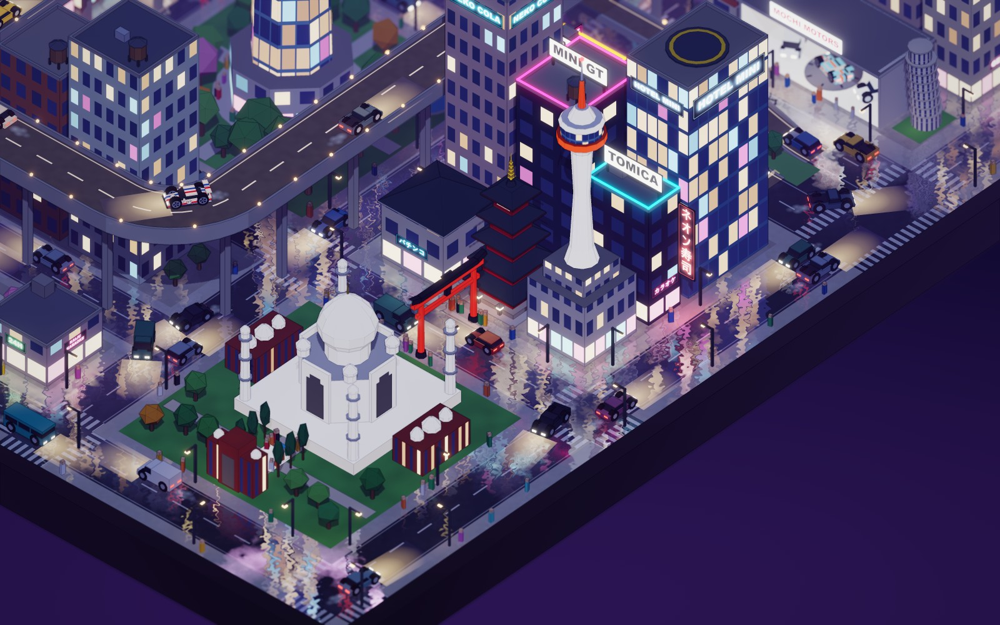 |  |
| Asia at night: Kyoto Tower, a pagoda behind its torii, and the Taj Mahal. | The flyover comes down between Asia and Europe. |
| 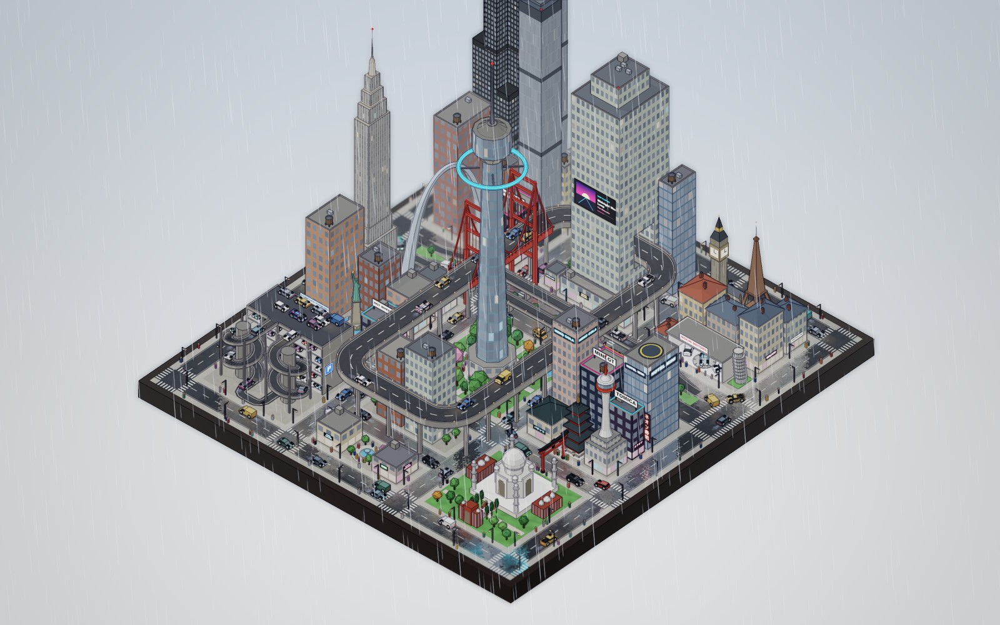 |  |
| Rain. | Snow. |
|  | 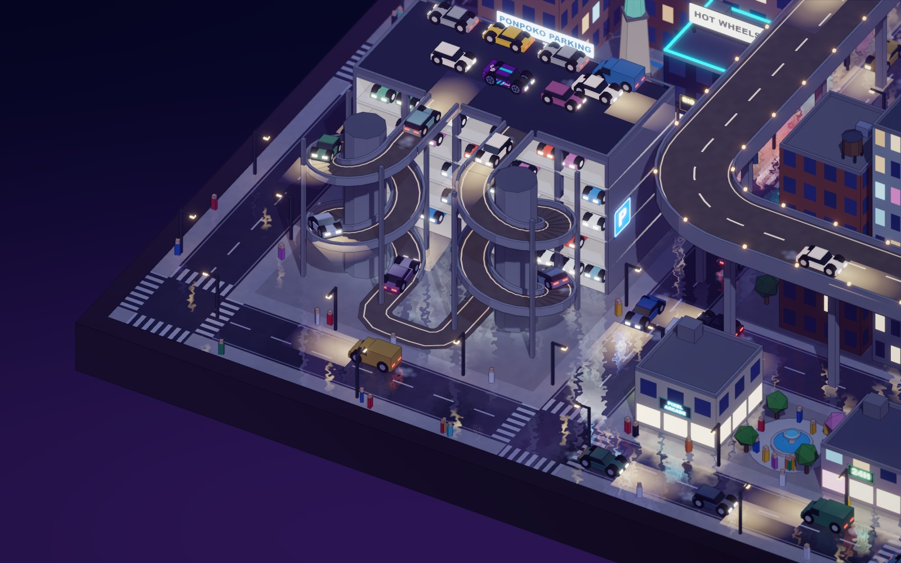 |
| Fog. | The car park and its spiral ramps. |

Famous landmarks stand in the city as toy versions of themselves, each on the tile of its own place. Most brands on the signs are invented. A few are real names from car culture, set in plain lettering.

## What is in this repository

| Path | What it is |
| --- | --- |
| [docs/brief.md](docs/brief.md) | The agreed design, in full. Start here. |
| [CONTEXT.md](CONTEXT.md) | The glossary: what a diecast, a hero, a casting, a tile, the board and the rest mean here. |
| [docs/adr](docs/adr) | Twelve short records of decisions that would be hard to undo, each with its reason. |
| [docs/building-a-tile.md](docs/building-a-tile.md) | The page for whoever builds a tile: what a tile is, the kit, the checks, and what the earlier tiles taught their builders. |
| [docs/districts/research](docs/districts/research) | The research notes behind the tiles on the board: what stands where, what it looks like, and what was and was not checked. |
| [app](app) | The real app, built with three.js: an engine, and a folder for each tile. So far nine tiles. |
| [app/src/engine/room](app/src/engine/room) | The collector's room round the table: the desk, the map on it with a pin for each tile, and the room the desk stands in. |
| [app/src/music](app/src/music) | The link to Spotify, which puts what is playing on the big screens of the city. |
| [supabase](supabase) | The backend's database, as the changes that made it: the heroes, the store for their models, and who may see them. |
| [prototype/look](prototype/look) | The look prototype. Its README says what to judge and what is faked. |
| [prototype/hero](prototype/hero) | The generator trial: prepares a diecast's pictures, runs them through image-to-3D services and shows the models side by side. The pictures and models themselves stay private. |

## Run it

```bash
cd app
npm install
npm run dev
```

Then open http://localhost:5187. The look prototype runs the same way from `prototype/look`, on port 5183.

## A note on names

This is a personal hobby project. Hot Wheels, Mini GT, Tarmac Works, TINY, Goodyear, Tomica, Advan, Michelin and Pirelli are trademarks of their owners. Their names appear here and on a few signs in the city as a nod from a fan, in plain lettering and without their logos. This project is not affiliated with or endorsed by any of them.

The same goes for the places. Real buildings, clubs, circuits and businesses are named as a visitor would name them, without logos or crests, and each is drawn as a toy in the project's own hand. Westeros is the world of George R. R. Martin's *A Song of Ice and Fire*. It appears here as a fan's homage after the books' descriptions, not for sale, and with no connection to the author, his publishers or the makers of the television series.
