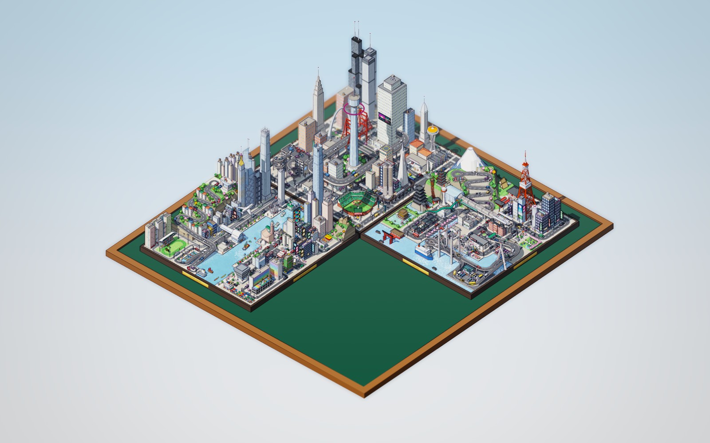

# The app

The real Wimmelstadt: a board of tiles, each a district built by hand, with traffic on its roads and the collector's heroes among it. See [0009](../docs/adr/0009-a-city-of-hand-built-tiles.md) for why the city is made of tiles and why a tile is the size it is, and [0010](../docs/adr/0010-the-tiles-stand-together-on-a-table.md) for how the tiles stand together.



The pictures of each tile are in the [README at the top](../README.md).

## The board and its tiles

Every tile stands on a base of its own, with its name on a brass plate on each side, and the bases stand edge to edge on one table. The tiles are put on it in rows, in the order they were built, so the first ones keep the back of the table.

| Tile | Things to find | What it is | Its notes |
| --- | --- | --- | --- |
| North America | 20, the L and a helicopter | The look prototype's board, kept as it was and made North American throughout: a ring of raised expressway round Halo Tower, a flyover, a car park with two spirals, and an elevated railway. | [NOTES.md](src/tiles/north-america/NOTES.md) |
| Japan | 41 | Fuji and a pass of hairpins, Kyoto and Tokyo on the two banks of a river with a Shinkansen between them, and the Wangan with Daikoku and Tatsumi. | [NOTES.md](src/tiles/japan/NOTES.md) |
| Hong Kong | 39 | Both sides of Victoria Harbour: the Peak and Central on one shore, Tsim Sha Tsui and Kowloon on the other, with trams, ferries and a jumbo jet. | [NOTES.md](src/tiles/hong-kong/NOTES.md) |

A tile's notes list what stands on it, the liberties taken with the real place, every real name on a sign and how it was checked, and what its builder learned.

Two things are true of every tile:

- **Scale.** The towers are roughly to one scale across the whole city, about 3.2 metres to a unit: the Sears Tower's roof is 140 units up. Small landmarks are larger than that, so that they can be recognised, and mountains are toys. Every vehicle is far too large for the buildings, as a toy car is beside a toy house.
- **Nothing leaves its tile.** A tile's roads loop back inside its own edge, and no road joins two tiles. A hero is put on a tile at random each time the page loads.

## Heroes

A hero is made from a capture's generated model, which is far too heavy to drive around: the first one came as 500,000 triangles and 28 MB.

```bash
node scripts/hero.ts countach-lb-works-black rodin-1 --name "Lamborghini Countach LB-WORKS"
```

This cuts the model to 12,000 triangles and a 1,024-pixel picture, about 1.5 MB, and writes it as `hero/hero.glb` in its capture's folder with a small `hero.json` beside it. Captures are private and are not in this repository, so neither are heroes. A hero is drawn in the city's own hand: flat bands of light, the photographed shine ironed out of its colours, and a dark outline. Each has a party trick of its own, in `src/heroes`.

Where the heroes come from depends on where the app runs:

- **On the collector's desk,** the development server hands the page every hero it finds among the captures, and there is no lock.
- **Everywhere else,** the heroes are in the backend, behind a PIN. The options have a row, Heroes, that opens a card for it. A device that has been unlocked keeps the heroes, so from then on the city starts with them even when the backend is asleep or out of reach, and it asks every half hour whether one has been added. Changing the PIN locks every device again. See [0011](../docs/adr/0011-the-heroes-sit-behind-a-pin.md).

A hero goes from the desk to the backend with one command, which sends its model and its record:

```bash
npm run send-hero -- countach-lb-works-black
```

Add `--dry` to see what would be sent. The command reads `SUPABASE_ACCESS_TOKEN` and `SUPABASE_PROJECT_REF` from `.env.local` at the top of the repository. With them it asks Supabase for the project's secret key each time it runs, and it neither prints nor saves it.

## Running it

```bash
npm install
npm run dev
```

Then open http://localhost:5187.

| To | Do this |
| --- | --- |
| Move the view | Drag, or use the arrow keys. |
| Turn it | Right-drag, drag with two fingers, or press Q and E. |
| Zoom | Scroll or pinch. |
| Go to a tile, or back to the whole board | Double-click the tile, or the table. Escape also goes back to the board. |
| Set the hour | Drag the sun round the dial. Touch the middle of the dial to follow the clock again. |
| Set the weather | Touch a token. The same one again gives the weather back to the city. |
| Ride along with a hero | The key with the car on it, or F. |
| Watch a day go by in 80 seconds | The key with two arrows, or T. |
| Change the depth of field, turn the view by itself, see how it performs, unlock the heroes | The key with three dots. |

The view stays wherever it is left. The plate at the top left names the tile under it, or the city when the whole board is in view.

The address bar takes options:

| Option | What it does |
| --- | --- |
| `?tiles=japan,hong-kong` | puts only those tiles on the board, in that order. A tile named twice stands there twice, and `sample` is the sample tile, which is hidden otherwise. |
| `?hour=21.5` | sets the hour. |
| `?weather=rain` | sets the weather: `clear`, `cloudy`, `rain`, `storm`, `fog` or `snow`. |
| `?drift=0` | stops the view turning by itself. |
| `?x=..&z=..&az=..&zoom=..` | starts with a view of its own. |
| `?place=<id>` | puts the heroes on one route or one place on show, by its id. |
| `?heroes=collection` | asks for the heroes from the backend, behind the PIN, as a built copy does. `desk` and `none` are the other two. |
| `?heroes=collection&backend=stand-in` | uses a stand-in for the backend, on the development server only, for trying the lock. Its PIN is 1234 and opens nothing else. See `vite.config.ts`. |

## Working on it

| Folder | What it holds |
| --- | --- |
| `src/engine` | Everything a tile is built with and everything that runs it: the builder for shapes, ground, roads, rails, buildings, signs, traffic and heroes, the look, the camera, and the board and its table. It knows no tile. |
| `src/tiles/<id>` | One tile: its plan as data, its landmarks, and its notes. A tile is found by its folder. `sample` uses every piece of the kit once. |
| `src/heroes` | The party tricks, one for each hero, by the name of its capture. |
| `src/collection` | Where the heroes come from: the desk, or the backend behind its PIN, and the copy a device keeps. |
| `src/ui` | The controls: the dial, the weather tokens, the keys, the plates and the card for the PIN. |
| `src/main.ts` | The page: it puts the tiles on the board, lights them by the hour and the weather, and draws them. |
| `scripts` | `hero.ts` makes a hero from a generated model, and `send-hero.ts` sends one to the backend. |

Whoever builds a tile starts with [the page for tile builders](../docs/building-a-tile.md).

From the browser's console, `wimmel.shot('name', { hour: 21.5, weather: 'rain', x: 68, z: 74, az: 42, zoom: 92 })` draws one picture of a view and saves it in `screenshots/`.

**Pictures and heroes.** A picture is public unless it shows a hero. So `wimmel.shot` leaves the heroes out. Ask for `heroes: true` and they are in the picture, and it is saved in the first hero's capture instead, under `captures/<capture>/screenshots/`, which is private.

### What it is not yet

- No road joins two tiles, and a hero does not travel from one to the next.
- Vehicles follow fixed loops. They do not choose a way or turn at a junction, and where two loops share a lane they merge. Real driving comes with the road network.
- There is no roster, no card and no bench. The one hero was carried through by hand.
- Nothing has a name on screen but the tile in view.
- How it runs on the phone has not been measured. On the desktop, three tiles take about 7 ms a frame.
