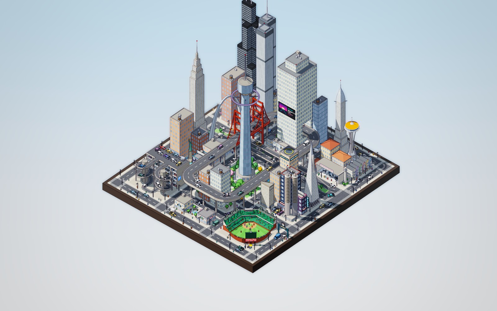
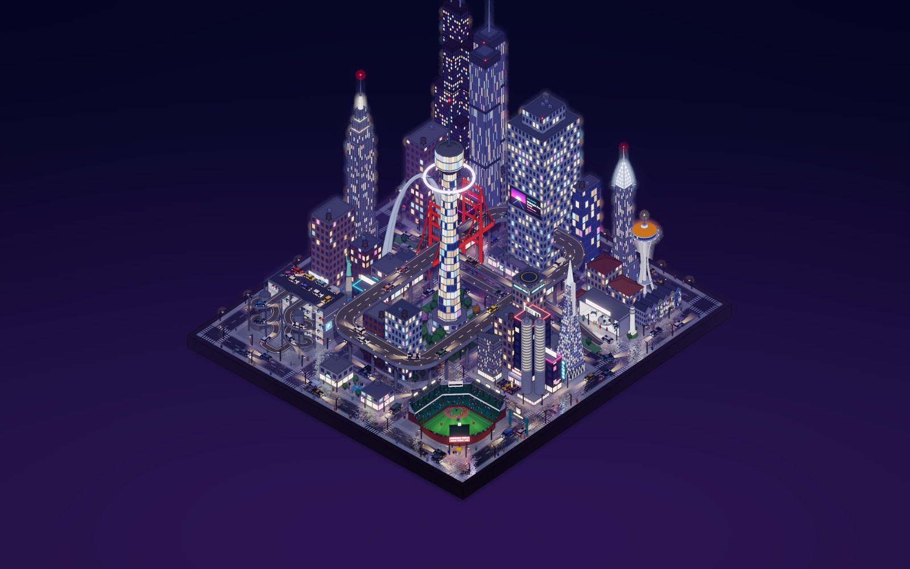
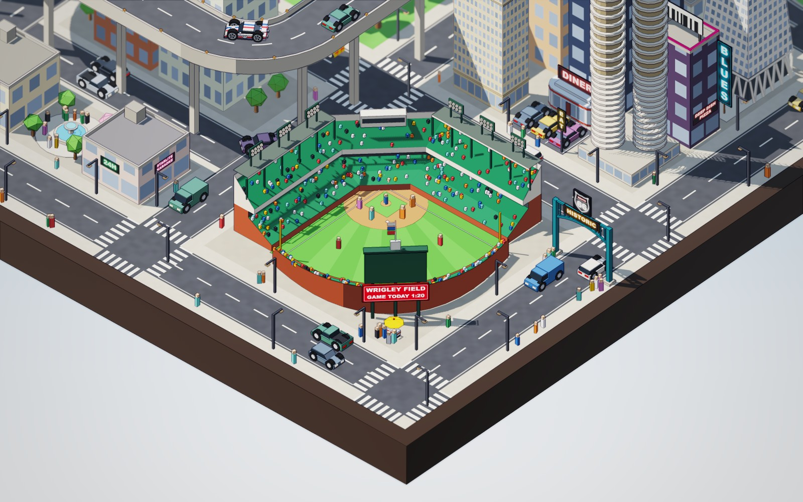
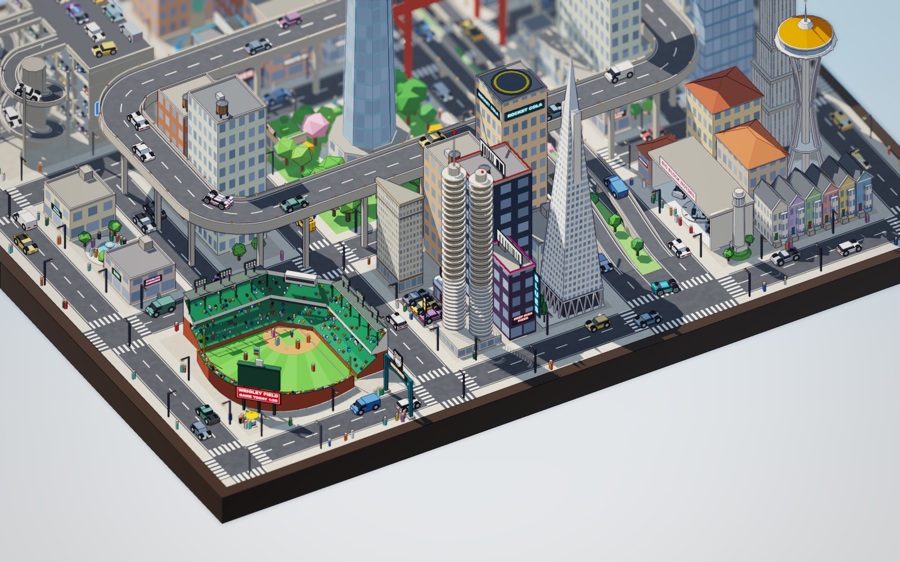
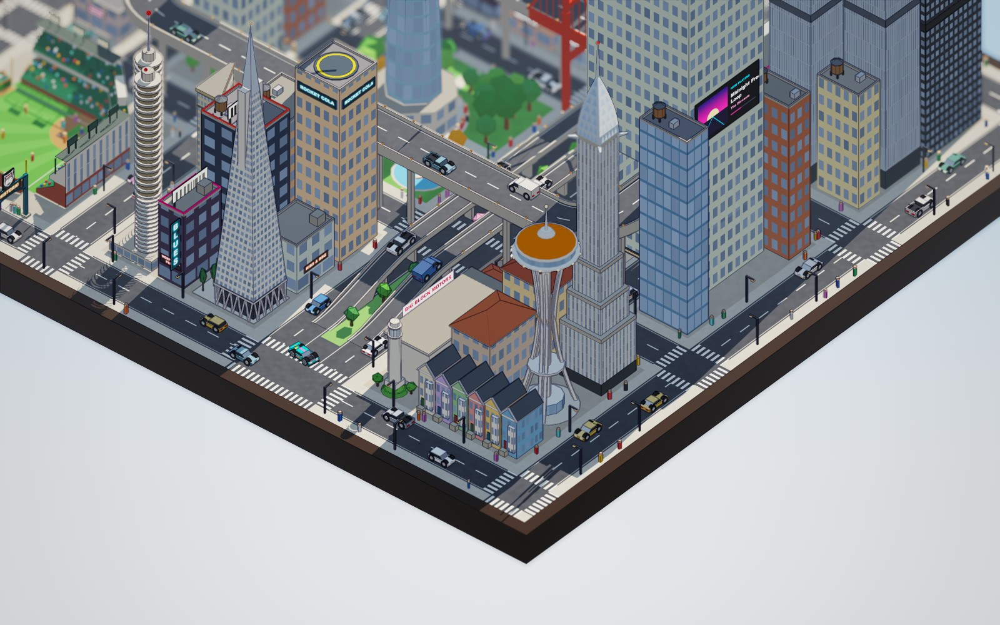
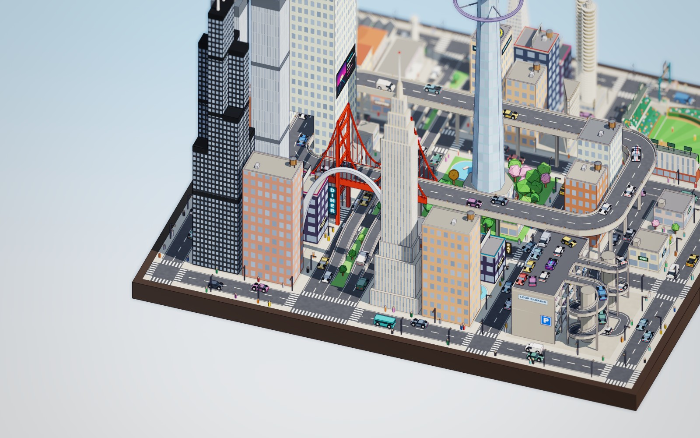
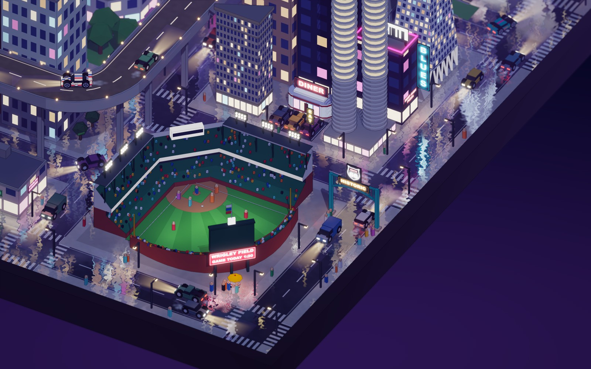

# The app

The real Wimmelstadt. So far the city is one tile, North America. It is the [look prototype](../prototype/look)'s board, kept as it was: the same size, the same streets, the same ring of raised expressway, flyover and car park, on the same base. What stands on it is North American throughout. See [0009](../docs/adr/0009-a-city-of-hand-built-tiles.md) for why the city is made of tiles and why a tile is this size.



| | |
| --- | --- |
|  |  |
| Half past nine in the evening. | Wrigley Field, the arch for Route 66, the diner and Marina City. |
|  |  |
| The east side: Marina City, the Transamerica Pyramid and the Flatiron Building. | The north-east: the Chrysler Building, the Space Needle, the Painted Ladies and Coit Tower. |
|  |  |
| The west side, which is the prototype's: the Sears Tower, the Gateway Arch, the Golden Gate Bridge and the Empire State Building. | A night game. |

There is one more in [screenshots](screenshots): the east side under snow.

## What is on the tile

The board is three blocks by three, with a boulevard between the first row and the second.

| Block | What stands there |
| --- | --- |
| North-west | The Sears Tower and the Twin Towers. |
| North | The Gate Tower, which is invented. The expressway runs through it, a street runs through its base, and it carries the big screen. |
| North-east | The Chrysler Building, the Space Needle, the Painted Ladies along the street on the east side, Coit Tower on its hill, and the showroom, Big Block Motors. |
| West | The Empire State Building, and the Statue of Liberty in her pond. The Gateway Arch spans the boulevard beside them, and the Golden Gate Bridge carries the expressway over it. |
| Middle | The park, with Halo Tower, which is invented. |
| East | The Transamerica Pyramid with redwoods beside it, the Flatiron Building, a diner with room to park in front, and Marina City. |
| South-west | The car park with its two spiral ramps, Loop Parking. |
| South | A street under the expressway, and a square with a fountain. |
| South-east | Wrigley Field. An arch for Route 66 stands over the street beside it. |

That is 20 things to recognise, where the prototype had 17.

### What changed from the prototype

Everything on the prototype's board that was North American or invented stayed. The rest was replaced.

| On the prototype | On the tile |
| --- | --- |
| Big Ben | The Chrysler Building |
| The Eiffel Tower | The Space Needle |
| The Leaning Tower of Pisa | Coit Tower |
| Stucco houses with chimneys | The Painted Ladies, and two stucco houses under clay tiles |
| A hotel with a helipad | The Transamerica Pyramid. The helipad moved to the tower with the cola's name on it. |
| A shop on the corner | The Flatiron Building |
| The pagoda | A diner |
| Kyoto Tower | Marina City |
| The torii | The arch for Route 66, which stands over the street on the east side |
| The Taj Mahal and its garden | Wrigley Field |
| Signs in Japanese, and the cafés and bakeries of Europe | Signs in English: deep dish pizza and blues in the east, coffee, sourdough and tacos in the north-east |
| Mochi Motors, Ponpoko Parking, Neko Cola, Kaiju Karaoke, Tofu Turbo, Wanwan Tires | Big Block Motors, Loop Parking, Rocket Cola, Starlite Karaoke, Turbo Tacos, Big Dog Tires |
| Tomica, Advan, Michelin and Pirelli on a few boards | Goodyear, beside Hot Wheels and Mini GT |

The models that left are still in the look prototype, and wait there for tiles of their own places.

Two things are not as they are in life:

- **The marquee.** Wrigley Field's red marquee hangs under the scoreboard, over the gate to the bleachers. The real one is on the corner behind home plate. On this tile that corner faces the expressway and the Gate Tower, and no view of the city can see it.
- **Scale.** Each landmark is a toy at a size of its own, as on the prototype. The Statue of Liberty is not to the scale of the tower behind her, and every vehicle is far too large for the buildings.

## Heroes

A hero is made from a capture's generated model, which is far too heavy to drive around: the first one came as 500,000 triangles and 28 MB.

```bash
node scripts/hero.ts countach-lb-works-black rodin-1 --name "Lamborghini Countach LB-WORKS"
```

This cuts the model to 12,000 triangles and a 1,024-pixel picture, about 1.5 MB, and writes it as `hero/hero.glb` in its capture's folder with a small `hero.json` beside it. Captures are private and are not in this repository, so neither are heroes.

The tile has five stand-in heroes, drawn by hand, as the prototype had. The development server hands the page every real hero it finds, and each takes the place of a stand-in: first the one on the expressway, then the one on the boulevard, then the one on the street round the park, then the one on the showroom's turntable, then the one on the car park's roof. A real hero is drawn in the city's own hand: flat bands of light, the photographed shine ironed out of its colours, and a dark outline. A built copy of the app has no real heroes yet, only the stand-ins. They will come from the backend.

## Running it

```bash
npm install
npm run dev
```

Then open http://localhost:5187. Drag to move, right-drag or Shift-drag to turn, scroll or pinch to zoom. The bar at the bottom sets the hour, follows a hero, and steps through the weather and the focus. The controls, the keys and the options in the address bar are the look prototype's, and [its README](../prototype/look/README.md) lists them all.

## Working on it

| File | What it holds |
| --- | --- |
| `src/scene-data.ts` | The tile's plan: its streets and blocks, every lot, the roads that vehicles follow, where vehicles are parked, and every sign. Nothing in it draws anything. |
| `src/landmarks.ts` | The models of famous things, each a few dozen boxes, cylinders and bars. |
| `src/city.ts` | Builds everything that stands still from the plan. |
| `src/vehicles.ts` | Traffic and heroes. |
| `src/hero.ts` | Loads the heroes made from real diecasts and dresses them in the city's look. |
| `src/signs.ts` | Draws every sign onto one sheet. |
| `src/materials.ts`, `src/post.ts`, `src/atmosphere.ts`, `src/weather.ts` | The look: flat bands of light, outlines, a shallow focus, glow, the light of each hour, and the weather. |
| `src/camera.ts`, `src/paths.ts`, `src/geo.ts`, `src/main.ts` | The view, the lines that roads follow, the builder that every shape is made with, and the page itself. |

From the browser's console, `wimmel.shot('name', { hour: 21.5, weather: 'rain', x: 68, z: 74, az: 42, zoom: 92 })` draws one picture of a view and saves it.

**Pictures and real heroes.** A picture is public unless it shows a real hero. So `wimmel.shot` leaves the real heroes out: the stand-ins drive in their places, and the picture goes in `screenshots/`. Ask for `heroes: true` and the real heroes are in the picture, and it is saved in the first hero's capture instead, under `captures/<capture>/screenshots/`, which is private.

### What it is not yet

- The city is one tile. How tiles sit together, and how a hero gets from one to the next, is not decided.
- Vehicles follow fixed loops: round a block, round the expressway, up one spiral and down the other. They do not choose a way or turn at a junction. Real driving comes with the road network.
- New Orleans, which the research for this district also covers, has nothing on the tile.
- Nothing has a name on screen. Names that appear as the view zooms were tried on the two-tile blockout and are not here yet.
- How it runs on the phone has not been measured.
