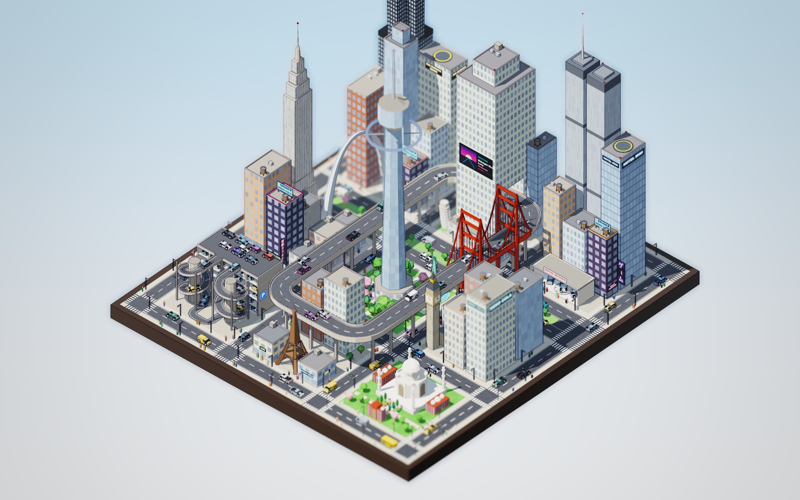
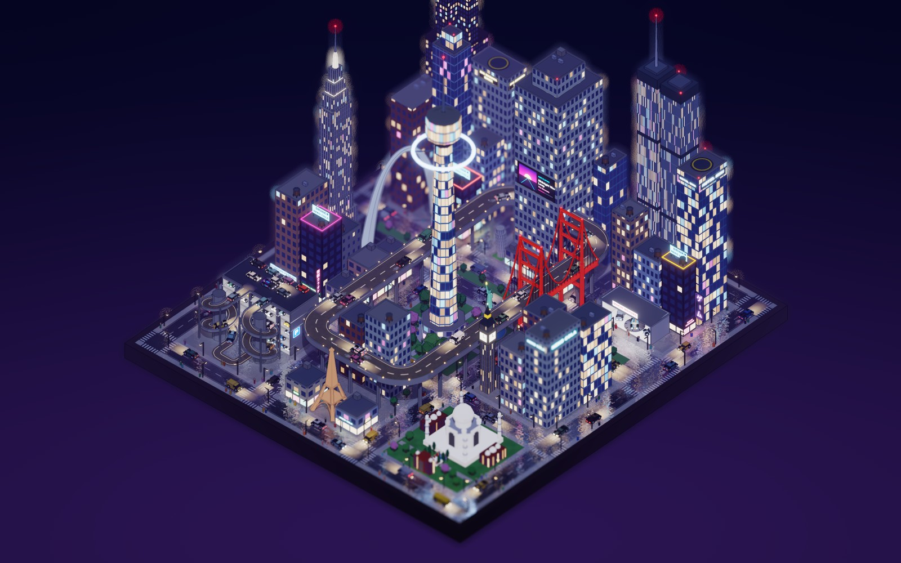
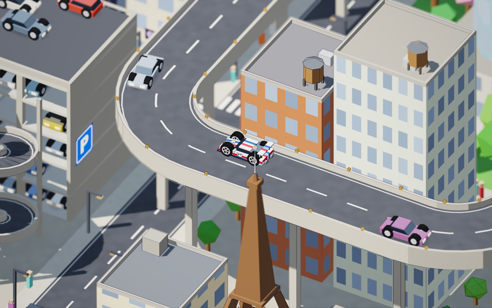
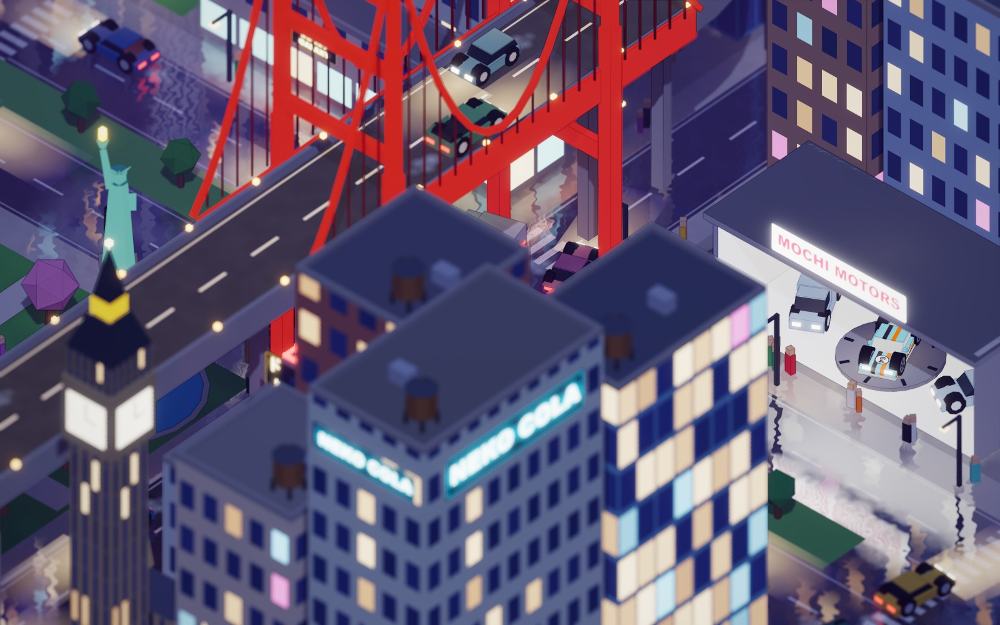
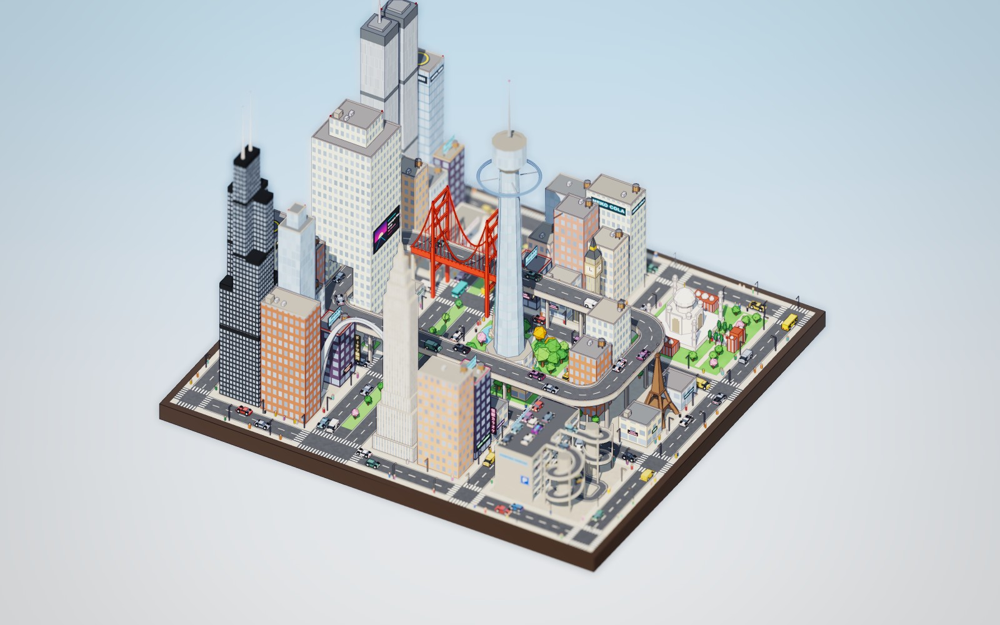
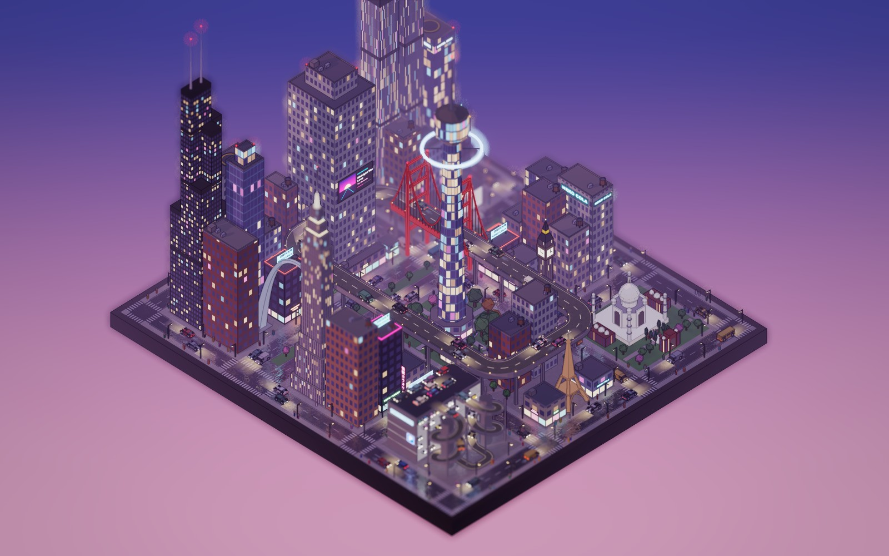

# Wimmelstadt: the look prototype

A throwaway. One small hand-built scene to judge the look by day and by night before anything real is built. Nothing here is meant to survive into the real app except what it teaches. The design it tests is in [docs/brief.md](../../docs/brief.md).

**Live:** https://anubhavg1999.github.io/wimmelstadt/

## What it looks like

| Day, 11:00 | Night, 21:30 |
| --- | --- |
|  |  |
|  |  |
|  |  |

More in [screenshots](screenshots): the arch, the bridge, the Taj Mahal at night, the car park at night.

## Run it

```bash
npm install
```

```bash
npm run dev
```

Then open http://localhost:5183. Other commands:

- `npm run build` writes static files to `dist/`. Their paths are relative, so the build works from any sub-path.
- `npm run preview:subpath` serves that build under `/wimmelstadt/look/`, to check exactly that.
- `npm run typecheck` checks the types.

## Controls

- **Move:** drag. **Turn:** right-drag, Shift-drag, or twist with two fingers. **Zoom:** wheel or pinch.
- **The dial** at the bottom drags to any hour and pins it. **live** follows the clock again.
- **follow** rides along with a hero and cycles through all five. The focus follows the hero too. Dragging the view lets go.
- **time-lapse** runs a whole day in 80 seconds. **stats** shows frame time and draw calls.
- Keys: `D` day, `N` night, `L` live, `T` time-lapse, `F` follow, `S` stats, `O` drift on or off, arrows to move, `Q` `E` to turn, `+` `-` to zoom.

Left alone, the interface fades after a few seconds, the camera starts to drift after 12 seconds, and after a minute calm mode caps drawing at 30 frames a second. Any input brings it all back.

### Fidelity and frame rate

- **With a mouse** (a desktop), the picture is drawn at twice the size of the screen and scaled down, which smooths the edges of straight lines. It stops short of that if it would pass 9 megapixels.
- **With touch** (a phone), the picture is drawn at the screen's own size, at most two pixels per point.
- **Frames are capped at about 60 a second.** A screen that refreshes faster is drawn on every second, third or fourth refresh, so the motion stays even: 60 on a 120 Hz screen, 72 on a 144 Hz one.

### Options in the address bar

| Option | Meaning |
| --- | --- |
| `?hour=22` | Pin the hour |
| `?az=42&zoom=250&x=0&z=4` | Start from a given view |
| `?follow=0` | Follow hero 0 to 4 |
| `?stats=1`, `?drift=0` | Show stats, stop the drift |
| `?ss=1`, `?mp=6` | How many times the screen's size the picture is drawn at, and the megapixel bound |
| `?fps=60` | The frame cap. 240 or more switches it off |
| `?dpr=1.5` | Pixel ratio (default: the screen's, at most 2) |
| `?msaa=0`, `?shadow=1024` | Edge smoothing samples, shadow map size |
| `?bloom=0`, `?refl=0`, `?outline=0`, `?tilt=0` | Switch off the glow, the wet-street mirror, the outlines, the shallow focus |

The last four rows are for finding out what costs what on a phone.

## What to judge

1. **Does it read as a miniature?** Toy size, the shallow focus, the soft outlines. Too much blur, too little?
2. **The cel shading.** Flat bands of light and soft outlines. Is "lightly cel-shaded" this, or more, or less?
3. **Density against visibility.** It should feel packed and still show enough road. The elevated expressway, the spiral ramps, the rooftop car park and the showroom are there to keep vehicles in view. Turn the city and see which sides work.
4. **Spotting a hero.** Five stand-ins drive and park among about 115 plain vehicles. Can you find them zoomed out? Are they clearly somebody when you zoom in? Nothing marks them.
5. **The landmarks.** Do toy versions of real places sit well among invented buildings?
6. **Day.** A bright, warm miniature. Try 8:00, 13:00 and 17:00.
7. **Night.** Neon, haze, wet-look streets with the signs mirrored in them, a sheen of the signs on paint, a little spray behind the wheels. Try 19:00, 20:00 and 22:00.
8. **Left alone.** Would you leave this on a stand beside you?

## What is in the scene

- Nine blocks on a board of about two by two metres at toy size, with a boulevard, eight streets, and a park in the middle.
- An invented tower with a glowing ring, an expressway that circles the park and runs through a gate tower, a showroom that opens onto the boulevard with a hero on a turntable, and a car park with five open floors, a roof deck and two spiral ramps.
- Ten toy versions of famous landmarks:
  - **On building lots:** the Sears Tower, the Twin Towers, the Empire State Building, Big Ben, the Eiffel Tower and the Leaning Tower of Pisa.
  - **Standing free:** the Gateway Arch across the boulevard, the Golden Gate Bridge carrying the expressway, the Statue of Liberty in the park's pond, and the Taj Mahal with its garden.
- 78 moving vehicles on 14 loops, 42 parked, about 220 still figures, 58 trees, 61 signs. Every brand is invented.
- Five hero stand-ins: three bodies, two of them again in other colours and decals. The same casting in another colour is a different hero.

## How it is put together

| File | What it holds |
| --- | --- |
| `src/scene-data.ts` | The scene as data: streets, buildings, roads, heroes, parking, signs, where the landmarks stand. Nothing in it draws. |
| `src/paths.ts` | Roads as lines to follow: rounded corners and spirals, sampled evenly. |
| `src/geo.ts` | Collects flat-shaded quads into one mesh, so the static city is a few draw calls. |
| `src/city.ts` | Builds everything that stands still from the data, and paints the map of street light. |
| `src/landmarks.ts` | The toy versions of famous buildings and monuments. |
| `src/vehicles.ts` | Traffic in five batches, heroes with decal sheets and turning wheels, the driving itself. |
| `src/materials.ts` | The cel shading, windows that light up, the ground with its markings and wet look. |
| `src/atmosphere.ts` | The light at every hour: a dozen hand-set moments, blended. |
| `src/post.ts` | Glow, outlines from depth, the shallow focus, final colour. |
| `src/camera.ts` | The isometric camera and its controls. |
| `src/signs.ts` | Draws every sign onto one sheet. |
| `src/main.ts` | Ties it together: options, the loop, the dial, stats. |

How a frame is drawn: at night the scene is drawn once from below the ground, at half size, for the wet streets. Then the scene is drawn once into an off-screen picture with its depth. The glow is made from a shrunken copy of that picture. One last pass blurs by depth, draws the outlines from depth, adds the glow and sets the colour. Sun shadows are drawn only when the sun has moved.

The pictures in `screenshots/` were taken by the page itself. Under `npm run dev`, `wimmel.shot('name.jpg', { hour: 21.5 })` in the browser console draws one picture without the interface and saves it there.

## Measured

On the development machine (RTX 3070), drawing 150 frames back to back and waiting for each to finish:

| View on screen | Picture drawn | Day | Night |
| --- | --- | --- | --- |
| 1024 × 768 | 2048 × 1536 | 3.2 ms | 3.0 ms |

By day that is 62 draw calls and 76 thousand triangles. At night it is 112 and 152 thousand, because the mirror image draws the scene a second time.

Nothing has been measured on a phone yet. That is the next job for this prototype.

## Risks for a phone

- **Filling pixels, not triangles.** The cost is in the full-size off-screen picture, the blur, the glow and the mirror image. The switches above exist to find the worst of them. Lowering the pixel ratio is the strongest lever.
- **Heat over an hour.** A phone that is fine for five minutes may slow down after thirty. The frame cap and calm mode help. Lowering the pixel ratio while calm would help more and is not built.
- **Memory.** The off-screen pictures use 16-bit colour. Edge smoothing multiplies that, so it is off by default on touch devices.
- **Losing the graphics context.** A phone can take it away when the app goes to the background. The prototype does not recover from that and would need a reload.
- **Precision.** The outlines need high-precision depth. iPhones provide it. Some cheaper phones do not.
- **Fonts.** The signs are drawn with whatever Japanese font the device has, so they will look a little different on an iPhone.
- **Staying awake.** The page asks the browser to keep the screen on after the first touch. The stats show whether it was granted. Whether the Duo honours it from the Home Screen is one of the things to test.

## What I would do differently in the real build

- **A real traffic model.** Here every loop only turns right, so nothing ever crosses and nobody ever waits. It looks busy and is a trick. Believable driving needs junctions, signals and merging.
- **A city generator behind the same data shape.** `scene-data.ts` is the interface worth keeping: the builder does not care whether a person or a generator wrote the data.
- **Light that is authored per district.** The map of street light is painted once from lamps and signs. It works well and is cheap. It should become part of what a district delivers.
- **Hero paint that reflects the scene.** The sheen on paint is read from the street-light map, which is a good fake. Real heroes with photographed decals may need something better.
- **People that move.** They stand still here.
- **Quality levels.** One setting does not fit a desktop and a phone. Pixel ratio, shadows, the mirror image and the blur should step down by themselves when frames get slow.
- **Tests.** There are none. The road builder and the driving rules are the parts that would want them first.

## Things that are faked

- The sun's path is turned 40° against the street grid, as Manhattan's grid is turned against the compass, so that midday light rakes across the streets.
- Wet streets appear whenever it is night. There is no weather.
- Shopfronts, windows and lamps do not really light anything. A painted map of light does.
- Vehicles cast only a soft blob of shadow. Buildings cast real ones.
- The landmarks are not to one scale. Each is sized to fit its lot, as souvenirs are.
