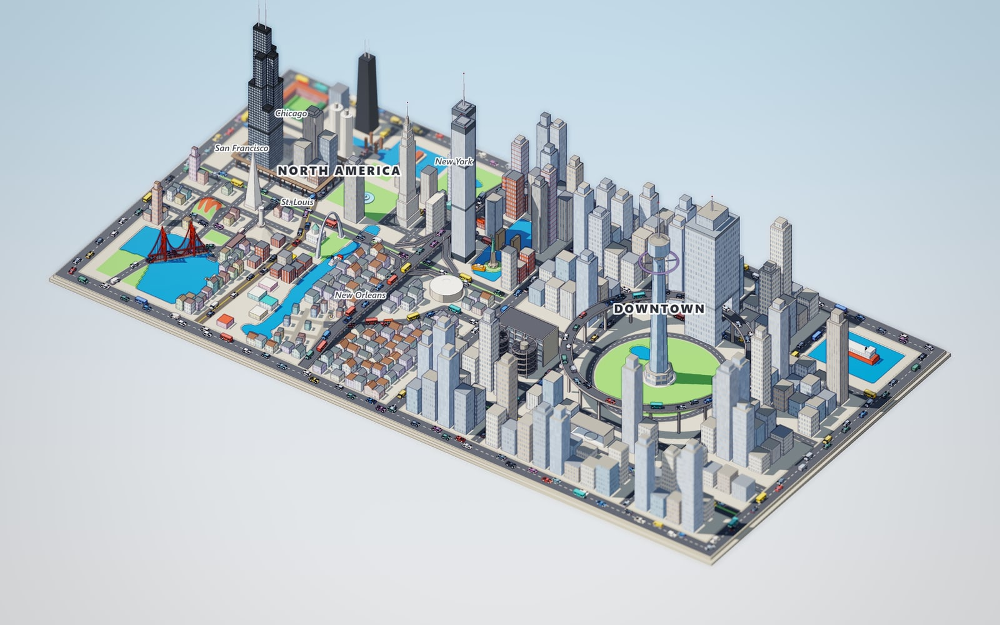
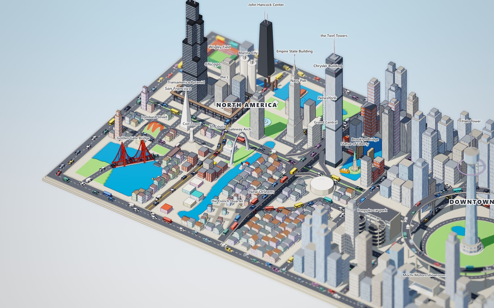
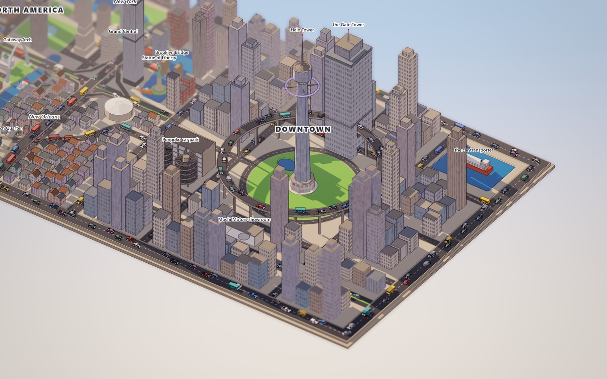
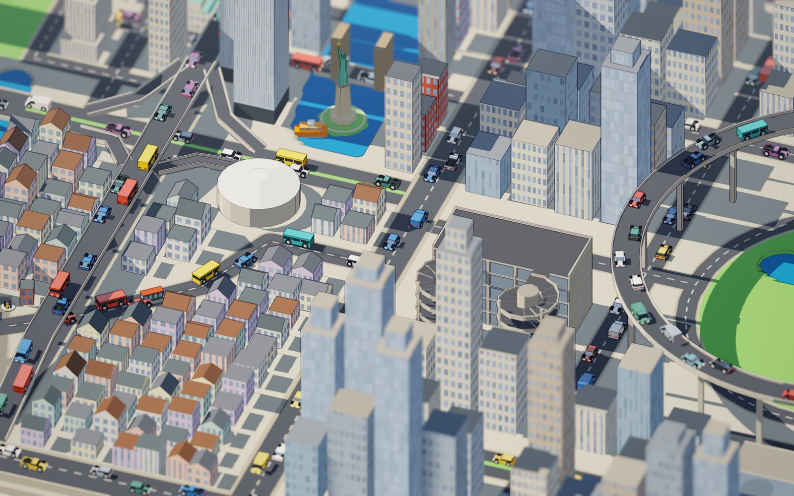
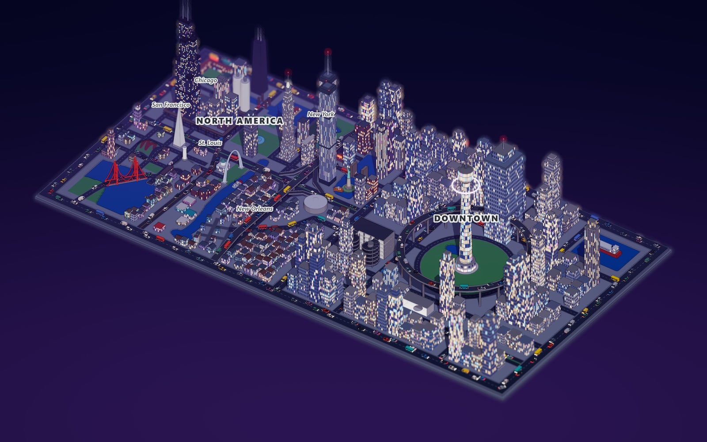

# The two-tile blockout

> **Set aside on 19 November 2026.** This was the first try at a city made of tiles: two tiles of 280 units a side, North America and Downtown, blocked out next to each other with an avenue between them. It is kept as a record and nothing is built on it. The city's tiles are now the size and shape of the [look prototype](../look)'s board, and the first of them is in [the app](../../app). See [0009](../../docs/adr/0009-a-city-of-hand-built-tiles.md).

## Why it was set aside

Seen beside the look prototype, the prototype's board was the better tile:

- **Its size.** A tile of 280 units has two thirds more ground than the prototype's board of 208 by 226. Spread over that much ground the same landmarks stand further apart, and the gaps fill with ordinary buildings. The prototype is dense because it is small.
- **Its roads.** The prototype has a raised expressway in a ring, with streets passing under it right beside tall towers. That reads better than a boulevard and a freeway crossing on open ground.
- **Its base.** The prototype stands on a board of its own, like a model on a table, and that is much of why it looks like a miniature. Tiles that share avenues on one large board lose it.

A Downtown tile was dropped for a different reason. A tile of towers round a ring road already looks like a downtown, and other tiles will too, so the city does not need one set apart.

## What is worth taking from it

- **The stack.** Where North America's boulevard passes under its raised freeway, four ramps climb from the boulevard to the freeway, one in each corner of the crossing. It is a road pattern for a later tile. The ramps are the four `stack-` roads in [src/city/north-america.ts](src/city/north-america.ts), and [src/world/roads.ts](src/world/roads.ts) builds their decks and pillars.
- **A plan kept as data.** Each tile's water, streets, raised roads and things are a table that the builders read, so a tile can be changed without touching the code that draws it.
- **Ground with relief and water**, and decks that appear by themselves where a street crosses water.

## What it was

Two tiles, North America and Downtown, blocked out side by side with the avenues between and round them, to judge how tiles sit together before either got its detail.



| | |
| --- | --- |
|  |  |
| North America: a boulevard, a raised freeway and Route 66. | Downtown: the ring road round the park. |
|  |  |
| The avenue between the two. | Half past nine in the evening. |

## What a blockout is

A tile is blocked out before it is detailed. A blockout has the tile's real ground, water and roads, but only some of what stands on them:

- **The models the tile already has.** North America has six, all from the look prototype: the Sears Tower, the Twin Towers, the Empire State Building, the Statue of Liberty, the Gateway Arch and the Golden Gate Bridge. Downtown has four: Halo Tower, the Gate Tower, the showroom and the car park.
- **A rough shape for every other thing** the tile will hold: a few boxes and drums that give its size, place and colour. North America has 25 of these, from the Chrysler Building to a hot-dog cart. Downtown has one, the car transporter in its harbour, because the rest of what belongs there is still to be thought up.
- **Plain volumes where ordinary buildings will be.** They fill each quarter from kerb to kerb in that quarter's sizes and colours, so that the tile's density and street pattern can be judged. They are placed by rule and every one is replaced by a building chosen by hand when the tile is detailed.

So a blockout answers whether the tile's layout works. It does not show the finished tile: there are no signs, trees or people, and no shop is yet a particular shop.

## The plan

A tile is built from its plan, which is kept as data in [src/city](src/city):

| File | What it holds |
| --- | --- |
| `plan.ts` | What a plan is made of: water, lawns, hills, streets, raised roads, rails, quarters and things. |
| `north-america.ts` | North America's plan: five cities, a boulevard, a raised freeway with a stack, and Route 66. |
| `downtown.ts` | Downtown's plan: the ring road round the park, and the street through the Gate Tower's base. |
| `city.ts` | Which tiles there are and where each stands. Moving a tile is a change to this table and nothing else. |

Everything in a plan is measured in the tile's own units, from its north-west corner. A tile is 280 units square and an avenue is 14 wide. A tile stands at street level all round its edge; inside, water is ground that dips below the water's level.

## Running it

```bash
npm install
npm run dev
```

Then open http://localhost:5189. Drag to move, right-drag or Shift-drag to turn, scroll or pinch to zoom. The bar at the bottom sets the hour, the weather, how shallow the focus is, and whether names show.

Both tiles are built from their plans when the page loads, in about a sixth of a second on a desktop:

- **The ground** of each tile, with its relief, its water and its painted streets. See `world/ground.ts`.
- **Raised roads** on their pillars, the L on its trestle, and a deck wherever a street crosses water. See `world/roads.ts`.
- **Models**, in `world/landmarks.ts`, and **rough shapes and plain volumes**, in `world/massing.ts`.
- **The avenues** and the board the city stands on. See `world/avenues.ts`.
- **Toy traffic**, about 320 vehicles, on the avenues, the boulevards, the freeway, the ring road and Route 66. See `world/traffic.ts`.
- **Names** of tiles, quarters and things, which appear and give way to each other as the view zooms.

The look is the prototype's, in [src/look](src/look): flat bands of light, soft outlines, shadows that follow the sun, a shallow focus, glow round lit things, the sky and light of each hour, and rain, storms, fog and snow.

### What it is not yet

- No tile has its detail. Everything listed under "What a blockout is" as missing is missing.
- Downtown needs its own list of things to recognise. A tile must hold at least 28; Downtown has five.
- Vehicles follow one road from end to end, turn round where it stops and pass through each other at junctions. They do not turn from a tile's road onto an avenue. Real driving comes with the road network.
- The stack's ramps and the car park's spirals carry no traffic.
- A tile's roads meet the avenue wherever the tile likes, so two tiles' main roads do not line up across it.
- Which side traffic keeps to on an avenue between a tile that drives on the left and one that drives on the right is not decided. Both of these tiles drive on the right.
- How it runs on the phone has not been measured.

## Heroes

A hero is made from a capture's generated model, which is far too heavy to drive around: the first one came as 500,000 triangles and 28 MB.

```bash
node scripts/hero.ts countach-lb-works-black rodin-1 --name "Lamborghini Countach LB-WORKS"
```

This cuts the model to 12,000 triangles and a 1,024-pixel picture, about 1.5 MB, and writes it as `hero/hero.glb` in its capture's folder with a small `hero.json` beside it. Captures are private and are not in this repository, so neither are heroes.

The development server hands the page every hero it finds. Each one is drawn in the city's own hand: flat bands of light, the photographed shine ironed out of its colours, and a dark outline. It joins the traffic on the avenue that runs round the city, and a button in the corner finds it and rides along with it. A built copy of the app has no heroes yet; they will come from the backend.

## Working on it

From the browser's console, `wimmel.go('hancock')` jumps to a thing or a tile by its id, and `wimmel.shot('name', { hour: 21.5, weather: 'rain' })` saves a picture of the view in `screenshots/`. A page in a hidden tab draws no frames of its own: `wimmel.frame()` draws one.

The address takes options: `?hour=22` pins the hour, `?weather=snow` the weather, `?names=0` hides the names, and `?ss=1` draws the picture at the screen's own size instead of twice as large.
